# AlwayGit User Manual

[简体中文](USER_MANUAL.zh-CN.md) | [Project home](../README.md)

This manual follows common Git tasks: inspecting changes, staging and committing, managing branches, and collaborating in AlwayGit. Display preferences and auxiliary views receive brief notes; see the [Workbench Specification](WORKBENCH_SPEC.en.md) for complete product behavior and feature boundaries.

Select More actions → Help & Guide, with its question-mark icon, in the upper-right corner of the Workbench to open the offline help. It includes quick start instructions, common tasks, common questions, and the full chapters of this manual. Its language follows the workbench setting.

**About the screenshots:** Both editions share the same images. Figures 51–52 share one `AlwayGit-Demo` sample snapshot and are reused in both READMEs. Figure 51 was updated on 2026-10-30 from the 1.8.0 source build (`186779a` plus this Show changes only change), showing only changed files and their necessary directories. Figure 52 retains the complete radial tree captured the same day from baseline `e7b7e0f`. Figures 03, 06, and 14 were captured on 2026-10-29 from the 1.8.0 source build (UI baseline `0c956b5`), showing two topic commits on the Merge side lane, 18 px lane spacing, continuous path colors, and node outlines matching their paths. Figures 04–05, 07, 09, 11, 13, 18, 23, 29, 38, 40–47, and 49–50 were captured on 2026-10-28 from the 1.8.0 source build (UI baseline `67d3097`), reflecting the default unified list, current selection states, and Diff styles. Figure 49 explicitly demonstrates optional split mode; Figure 50 shows the navigation boundary notice. Figures 05 and 38 retain their original settings scenes and omit the later path-display and wrapping options; use the current interface for those reading preferences. Other figures retain their 2026-10-24 source. Some still show the old sample name `AlwayGit`, original paths, and surrounding toolbar; the main sample repository is now `AlwayGit-Demo`. These differences do not change the dialog operations illustrated. Background Graphs in other images retain the original sample history; see [history filtering](#section-04-01) for how to read the current graph. Images show actual Workbench components with an English interface, the default theme on a light host, and sample data; the language page previews Chinese. Repository, author, Commit ID, history, Git-operation, and terminal states come from isolated sample RPC data, not real project records or validation of real remotes, authentication, Git, or terminal execution. The narrow sidebar figure demonstrates region navigation at that viewport size. Images exclude native VS Code chrome, native confirmations, and system folder pickers. Your names, paths, Commit IDs, and saved interface preferences may differ. See [Validation](VALIDATION.en.md#manual-screenshots) for the capture process and verification scope.

## Read by task

| Start here | Contents |
| --- | --- |
| [Quick start](#quick-start) | Add a repository, inspect a change, and make your first commit |
| Understand the workbench | [Installation and interface](#chapter-01), [selection and shortcuts](#section-12-01), [common terms](#section-12-02) |
| Everyday tasks | [Working Tree and commits](#chapter-03), [history and comparisons](#chapter-04), [branches and old revisions](#chapter-05), [remote collaboration](#chapter-08), [Stash](#chapter-07) |
| Find and review | [Combined history search](#section-04-02), [File History](#file-history), [Full Tree](#commit-tree), [Branch comparison](#branch-comparison) |
| Advanced tasks | [Merging and conflicts](#chapter-06), [history and Tags](#chapter-09), [repositories and groups](#chapter-02), [Worktrees](#chapter-10) |
| Recovery and large files | [Reflog recovery](#reflog-recovery), [Interactive Rebase](#interactive-rebase), [Worktree overview](#worktree-overview), [Git LFS](#git-lfs) |
| Terminals and help | [Embedded terminals](#chapter-13), [custom shortcuts](#shortcut-settings), [offline help](#help-guide) |
| Troubleshooting and reference | [Settings and common questions](#chapter-11), [shortcuts, terms, and task index](#chapter-12) |

## Quick start: make your first commit

Use a practice repository with existing Git history. Confirm the current branch and finish any active Git operation first. For installation, see [Install and launch](#section-01-02).

1. Open the AlwayGit launch sidebar and select **Open Workbench**. Use **Add…** in Repositories to add a repository, then double-click it or press Enter to enter it.
2. Edit and save a file in VS Code. Return to the workbench, select **Working Tree**, then select a file marked **Unstaged** in the default unified list to inspect its Diff.
3. Right-click the file you want to commit and choose **Stage**. Find its **Staged** entry in the unified list and check the actual content prepared for the commit. A remaining Unstaged entry for the same file represents additional changes on disk.
4. Select **Commit** in the top toolbar, enter a Commit Message in the dialog, then select **Commit**. Ordinary Commit selects all Staged files initially; you can deselect files. Other unstaged changes remain in the Working Tree. The optional split mode also provides **Commit…** in the Staged heading.
5. Select **View Commit** in the result banner, or open the new commit in History. Verify its message, file list, and any remaining changes.

**Result:** History contains a new commit with the Staged content you reviewed. To share your local commit, follow [Remote collaboration](#chapter-08) and Push it to a remote.

If Commit fails, keep the draft and expand the error details. Address the reported Git identity, hook, or other cause before retrying.

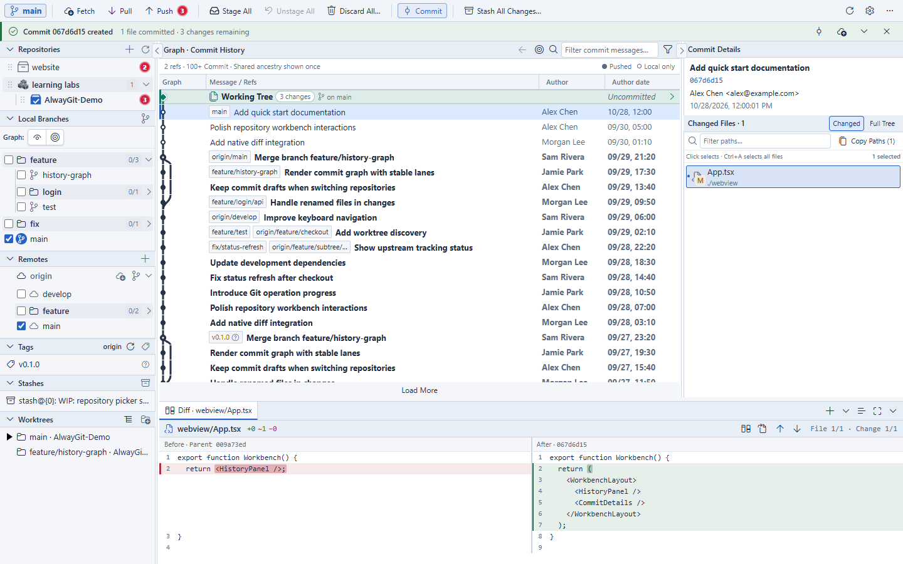

## Installation and the Workbench

AlwayGit brings Git repository navigation, commit history, file status, and read-only diffs into VS Code editor tabs and docked views. When you first use it, complete the “edit → Stage → check Staged → Commit” cycle in a practice repository before attempting remote synchronization or history rewriting.

The screenshots mostly show the English interface. Exact button names are retained so you can find each action. You can choose English or Simplified Chinese. Common actions and objects are translated in Simplified Chinese; Rebase, Cherry-pick, Graph, Stash, HEAD, Index, and Diff retain their Git names.

### Requirements

Use VS Code 1.106 or later. Basic features require Git 2.40 or later; saving a Stash of selected files and performing isolated restores with Apply / Pop require Git 2.43 or later; force-with-lease pushes, remote branch deletion and remote Tag deletion require Git 2.46 or later. Install AlwayGit from a VSIX package obtained from a source you trust. An existing project must already be a valid Git repository.

### Install the VSIX and launch AlwayGit

**Prerequisite:** You have obtained the installation package, VS Code can use Git, and you have confirmed that the project workspace is trustworthy.

1. Open the Extensions view in VS Code. From the view’s menu, choose Install from VSIX… and select the AlwayGit VSIX file.
2. After installation, check the extension details to confirm that the installed AlwayGit version matches the package. If VS Code prompts you to reload, do so.
3. Click the AlwayGit icon in the Activity Bar, then click Open Workbench. Alternatively, run AlwayGit: Show Workbench from the Command Palette.
4. On your first visit, use Add… under Repositories to add a repository, then double-click the target repository to open it.

**Result:** The AlwayGit workbench opens in its default location. Once the repository has loaded, you can see its branches and history.

**Troubleshooting:** If Git is unavailable, check its installation and the Git path configured in VS Code. If the workspace is in Restricted Mode, change its trust settings only after confirming that the project is trustworthy.

### Use a remote computer through Remote SSH

Install VS Code and Remote - SSH on the local computer, and enable SSH on the remote computer. The following steps use a Linux remote computer as an example. Linux release packages require a 64-bit glibc system and use Ubuntu 22.04+ / Debian 12+ as their compatibility baseline; other systems need separate validation. The basic Git requirements still apply; Git 2.46+ on the remote computer is recommended for all advanced operations.

1. Run **Remote-SSH: Connect to Host…** in VS Code on the local computer, connect to the remote computer, and open a project folder there. Check the SSH host in the status bar.
2. Obtain the package matching the remote computer from a trusted Release: `alwaygit-<version>-linux-x64.vsix` for Linux x64, or `alwaygit-<version>-linux-arm64.vsix` for Linux ARM64. Choose for the remote computer containing the repository, regardless of the local computer's platform; use `win32-x64` for local Windows x64 repositories.
3. In the window connected to the remote computer, run **Install from VSIX…** and select the package for its platform. Confirm that AlwayGit appears under **SSH: <hostname>**, rather than only under local extensions, and reload when prompted.
4. Open AlwayGit and add a repository on the remote computer, such as `/home/your-user/projects/demo`. Git operations and embedded terminals run on the remote computer; the interface appears on the local computer.
5. In the remote terminal, check `git --version`, your Git identity, and repository authentication. If a Git path is needed, set `alwaygit.gitPath` in Remote settings to the path on the remote computer, such as `/usr/bin/git`.

Installing a complete package through VS Code's Install from VSIX needs no separate Node.js, npm, Python, or compiler installation on the remote computer; VS Code manages its Server and extension runtime. The repository's unified installation script requires an existing Node.js and runs on the remote computer, from either an ordinary SSH terminal or a VS Code terminal. Select **VS Code Server** in the installation destination menu, or pass `--install-to server`; the script locates the management CLI automatically without asking you to choose a path or Server version. The default **Desktop** destination updates desktop VS Code on the remote computer running the script. Installing an existing package does not require project dependencies or build tools; building from source does. See [build and package verification](VALIDATION.en.md#packaging-and-local-update) for the menu and command options. Use **Developer: Show Running Extensions** to confirm that AlwayGit runs remotely. New blank workbench windows inherit the current SSH connection.

Actual terminals, authentication, and multiple windows from local Windows to a Linux ARM64 remote computer still require validation on the corresponding computers; see [validation boundaries](VALIDATION.en.md#validation-evidence-and-boundaries). If SSH works but the embedded terminal fails to load, confirm that the package matches the remote computer's operating system and CPU architecture.

### Choose display locations and the default entry

1. Use Configure display locations and default… on the launch page, More actions → Workbench Locations at the top of the Workbench, or the gear in an AlwayGit view title.
2. Enable one or more of Editor Tab, Primary Sidebar, Secondary Sidebar, and Panel. Keep at least one enabled.
3. Choose the default from enabled locations; disabling the default selects a remaining location.
4. Apply and Open saves and enters the default location. Cancel, Close, and Esc discard the draft.

The launch page shows the default and enabled locations and the opening destination. The AlwayGit status bar icon, Show Workbench command, and launch page button open or focus the default location. Enabling several locations does not open them all at once. The interface Settings gear inside the Workbench has a different purpose from the location control.

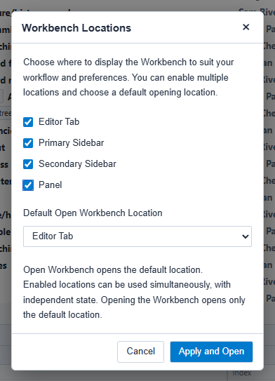

### Use multiple Workbench instances

The four locations can coexist. Each location and editor tab keeps its own repository, drafts, history filters, file selection, comparison, layout, and embedded terminals. Repository directories, actual Git state, and interface preferences are shared. The Primary Sidebar launcher remains available; disabling Secondary Sidebar or Panel hides its view while retaining its session, drafts, and running terminals for reopening.

Sidebar directions follow VS Code settings. Opening a location restores its native region. Narrow sidebars and short panels use region navigation for repositories, History, Details / Changes, and Diff / Terminal; switching regions retains selection.

Copy Current State to a New Editor Tab copies the repository, draft, and browsing state while retaining the source and existing tabs. Running terminals remain in the source. The launch page new-window entry creates an independent window with no repository selected.

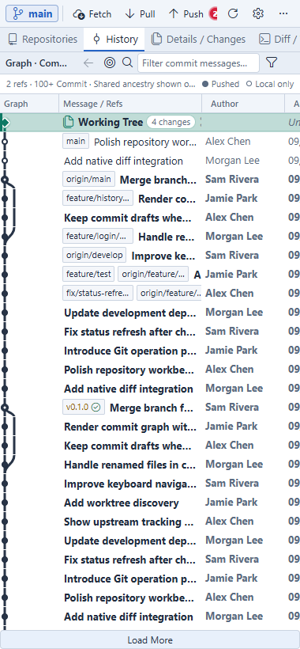

### Choose the display language

1. Click the gear in the upper-right corner to open Settings, then go to General → Language (常规 → 语言).
2. Select English or Simplified Chinese in the display-language list. The interface immediately previews your selection.
3. Click Apply (应用) to save. If you only want to try the language, click Cancel (取消) to revert the unsaved preview.

**Result:** The workbench uses your chosen language, and the applied selection remains when you reopen Settings.

**Caution:** File names, branch names, commit messages, and raw Git errors are not translated.

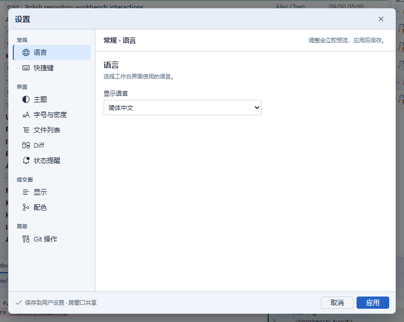

### Understand the four areas

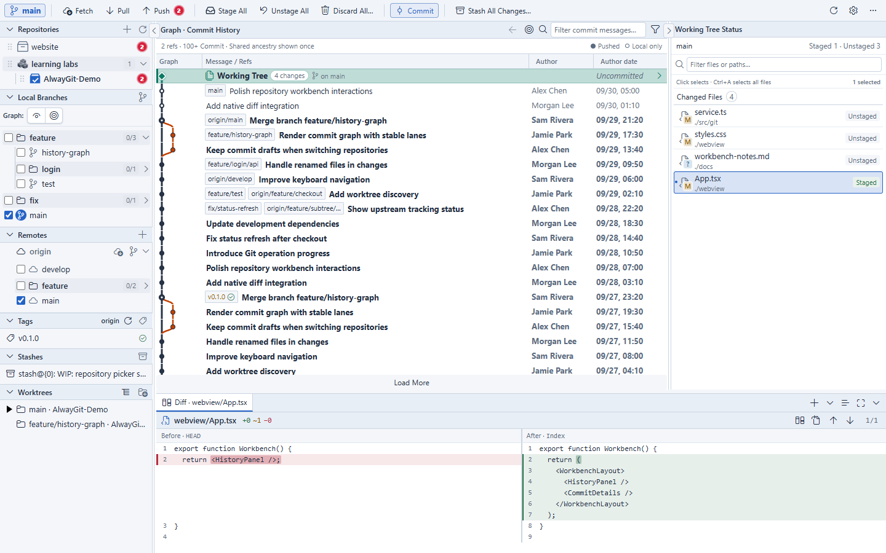

| Area | Purpose | What to check first |
| --- | --- | --- |
| Left navigation | Repositories, project groups, branches, remotes, Tag, Stash, and Worktree | The current repository and current branch |
| Center History | Commit graph, search, ref scope, and Working Tree | The commit or uncommitted changes you want to inspect |
| Right details | The commit’s file list or the Working Tree file list | Changed files and the scope of Staged changes |
| Bottom tabbed panel | A fixed Diff preview and multiple embedded terminals | The selected file comparison or terminal working directory |

Diff and embedded terminals share the bottom tab dock. See [embedded terminals](#section-13-01) for operations.

### How changes become a commit

Working Tree means the working files on disk; Index is the staging area for the next commit; a Commit is a version already saved in Git history. Stage places the selected files’ current changes into the Index. Ordinary Commit defaults to Index content. Commit Selected in the unified list can also stage and commit selected unstaged files.

### Find offline help and the full manual

Use More actions → Help & Guide with its question-mark icon, or Quick start in an empty Workbench. Its four categories are Quick start, Common tasks, Common questions, and Full manual. Search filters topic titles and body text in the current category only; clear the query or switch to Full manual if needed. Internal chapter links open the full chapter and locate the requested subsection.

Help follows the Workbench language. Both manuals and their images are included with the extension and work offline. Esc, Close, or the backdrop closes Help and returns focus to its entry. Reading Help does not execute Git, open projects, or change the repository, drafts, layout, or Diff.

## Working Tree and Commits

Staged is the most important place to check before committing. The default unified list labels each entry Unstaged or Staged; split mode displays separate groups. A file appearing as both unstaged and staged is not a contradiction: the Index contains one version, while the file on disk has changed again since it was staged.

| Status or group | Meaning | Recommended action |
| --- | --- | --- |
| Conflicts | Git still has unresolved conflict entries | First read “Merging and Resolving Conflicts” |
| Unstaged | Content on disk has not yet been placed in the staging area for the next commit | Review the Diff and select the files to stage |
| Staged | Changes in the Index that are ready to commit | Check the Diff in this area before using Commit |
| M / A / D / R | Modified / Added / Deleted / Renamed | Check both the file name and the complete parent directory path |
| ? / ! | Untracked / Conflict | Decide whether to track the file or resolve the conflict first |

### Choose split or unified file lists

Settings → Interface → File List uses the unified changed-files list by default and also offers the split list. This default applies when no display mode has been saved; existing split or unified preferences remain in effect until changed and applied here. The unified list places unstaged entries before staged entries and sorts each area by file name; conflicts come first. Each version has its own row and Diff. Stage All, Unstage All and Discard All in the top toolbar always operate on the complete repository, independently of filtering or selection. Discard All discards only unstaged changes and preserves staged content.

Split-mode heading actions use the current file filter; unified-mode toolbar bulk actions always use the whole repository. Use file context menus for selected files. Paths can use two lines, a single full-path line, or file names only; hover to read the full path. Display preferences do not change the action scope.

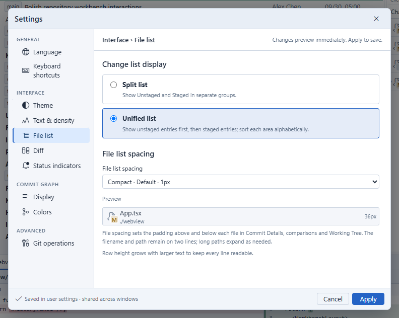

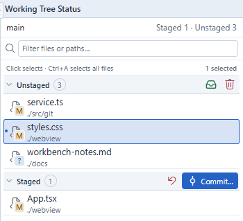

### Inspect a file’s actual Diff

**Prerequisite:** You have saved your changes in the editor.

1. Click Working Tree, then choose the file entry by its Unstaged or Staged label. In split mode, choose the file in the corresponding group.
2. Check the file and comparison targets in the Diff title at the bottom. In particular, confirm whether you are viewing Staged or Unstaged changes.
3. Use the previous and next arrows to review each change block, noting the counts of additions, modifications, and deletions.
4. To edit the full contents of a text file, use Open File in VS Code to open the actual file in the current Working Tree. This also applies when viewing a historical Commit or comparing two Commits: the file belongs to the current checkout and may differ from the preview. Save it, then return to the workbench and check again. A missing file produces an explicit message; it is neither created nor replaced by a Diff view. Images and other binary files are view-only in the AlwayGit preview.

**Result:** You can explain each block of changes you intend to keep and confirm that the comparison sources are correct.

**Caution:** The bottom Diff pane is read-only. PNG, JPEG and WebP changes appear side by side with zoom, synchronized scrolling, fit, 100% and maximize controls. Other binary files, oversized images and invalid text encodings show an explanation. VS Code editing and native Diff are disabled for images and other binary files.

**Troubleshooting:** If the content has not updated, first confirm that you saved it in the editor, then use Refresh. If the problem persists, check the output and error details.

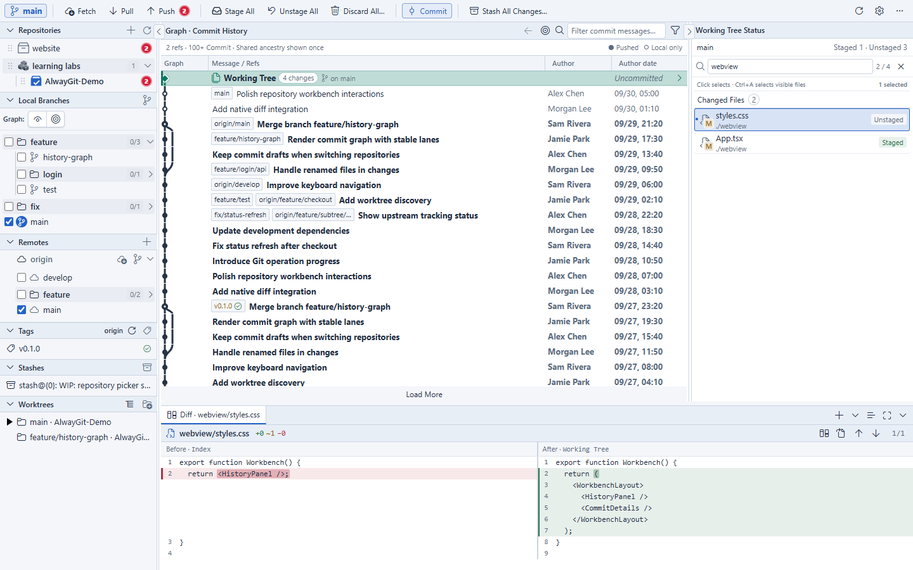

### Stage or Unstage specific files

**Prerequisite:** No unresolved conflicts remain, and you know which files should be included in the next commit.

1. Click the target entry marked Unstaged in the unified list, or enter the Unstaged group in split mode. Use Ctrl/Cmd or Shift to select multiple files.
2. Right-click an already selected file and choose Stage. Right-clicking an unselected file first changes the selection to that file alone.
3. Select the Staged entry to check the result. If you selected the wrong file, right-click that entry and choose Unstage.
4. For bulk actions in unified mode, use Stage All or Unstage All in the top toolbar; these always affect the complete repository. In split mode, use the corresponding group heading: without a filter it affects the whole group, and with a filter it affects matching files. Verify the count in the confirmation.

**Result:** Staged contains only the changes needed for this commit. After Unstage, the changes remain in the Working Tree.

**Work with individual hunks:** In an Unstaged text Diff, use “«” between the columns to stage the current change block. To discard that block, use its “»” action and check the confirmation. In a Staged Diff, “»” unstages the block while keeping Working Tree content. Actions handle contiguous change blocks rather than arbitrary line selections; discarding a complete untracked new-file block deletes the file. Recheck Staged afterward. Refresh a stale preview; use whole-file actions for unsupported files or active Git operations.

**Caution:** File menus and list bulk actions still operate on whole files. Filtering does not narrow the repository scope of the unified toolbar actions. Search file names or relative paths below the Working Tree summary, ignoring case; use the clear icon to restore all files. In split mode, group actions apply to the entire group without a filter, or only matching paths with a filter. Tooltips and confirmations show the scope, independently of the current selection. Use a file’s context menu to act on selected items. Ctrl/Cmd+A selects only visible files. Filtering does not change the actual Index; Ordinary Commit selects all staged files by default; you may deselect files in the checklist.

### Commit additions, deletions, and renames

**Prerequisite:** Use the VS Code Explorer to organize files, and back up important content.

1. Save newly created files, and confirm that files are no longer needed before deleting them. To rename a file, select it, press F2, and enter the new name.
2. Return to Working Tree and check for the question mark on new files, D on deleted files, or a rename status. If a rename initially appears as D at the old path and a question mark at the new path, first check the content of both.
3. Explicitly select the relevant paths and use Stage, then check them under Staged. Git may recognize the paired deletion and addition as R.
4. After committing, open the new commit directly in History to confirm the final paths and content.

**Result:** The additions, deletions, or renames are included in the intended commit, and you have checked how the content relates to the original files.

**Caution:** Rename detection depends on content similarity. Do not assume that a file has been lost solely because you see D and a question mark before committing.

### Commit while keeping unfinished changes

**Prerequisite:** At least one file is Staged, and you have prepared a commit message.

1. Check each Staged file, including deletions and renames.
2. Select Commit in the toolbar (split mode also offers Commit… in the Staged heading) and enter a Commit Message in the dialog. Confirm the repository, branch, and file checklist (all staged files are selected by default; you may deselect files), then select Commit or press Ctrl/Cmd+Enter. Enter inserts a new line.
3. Click the new commit in History to verify the actual file list. Then return to Working Tree and check the remaining uncommitted changes.
4. If Unstaged changes remain, continue editing or staging them for a separate commit.

**Result:** History contains one new commit, and only the content in the Index is included in it.

**Caution:** Drafts save automatically per repository. Cancel, Close, Escape and the backdrop preserve the complete message for the next opening, including after reopening the workbench. Failures also keep drafts; a successful Commit clears the draft used by that action. You can open the dialog to write a draft before staging; the submission button reflects the prerequisites. View Commit in the success banner opens the new commit returned by this operation. Check its actual file content.

**Troubleshooting:** If the commit fails, expand the Git error. Keep the draft, address the cause first, then recheck the scope of Staged changes.

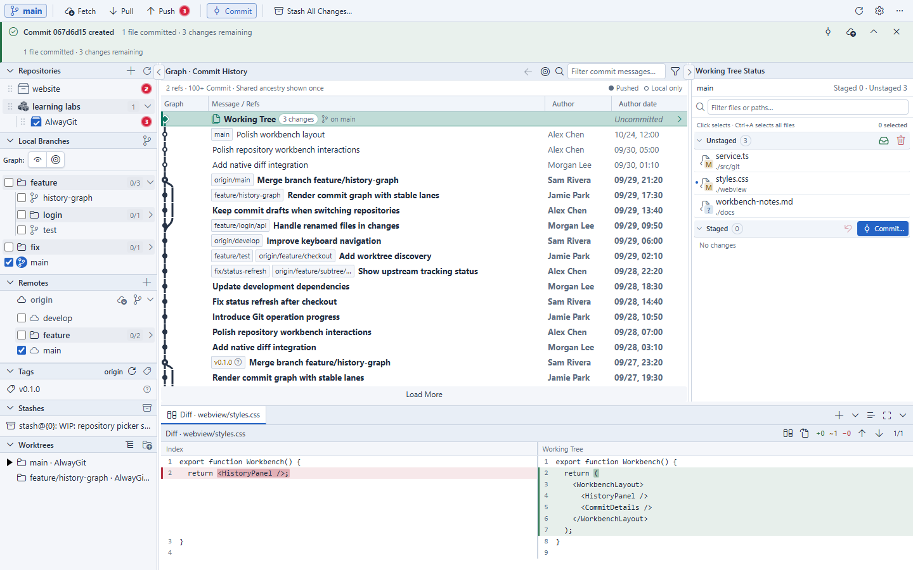

### Commit only selected files

In the unified list, Commit Selected… opens a checklist containing only the initially selected files. Each path appears once and may be deselected. Staged entries commit their Index version; unstaged entries automatically stage and commit the latest saved disk version. Selecting both versions uses the disk version once. An unstaged entry with staged changes is marked Combined, with one shared notice explaining that both parts are included. Unselected staged content is preserved; cancelling does not change the Index. Git hooks and signing run normally. Hooks may format selected files, but a candidate commit containing changes outside the selection is rejected before HEAD updates, preserving the original staged content. Hook changes on disk may remain; review them before retrying. During an active Git operation, review and commit the complete staged result.

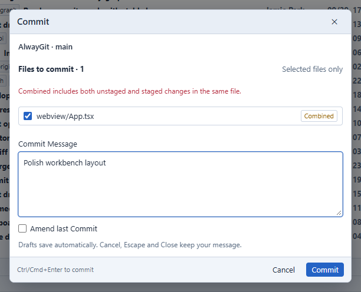

### Amend the last commit

**Caution:** Amend changes the commit ID. If the original commit has been pushed or used by others, coordinate with your collaborators first. Use View Commit in the completion banner or History to verify the new entry. Amend is unavailable while a Git operation is in progress.

**Prerequisite:** You have confirmed that the current HEAD is the commit you want to replace. Ideally, it has not yet been shared with others.

1. If you only need to change the commit message, you can leave Staged at 0. To add file content, first edit, save, and Stage the relevant files.
2. Open the Commit dialog and select Amend. An empty draft loads the current commit message; existing text is preserved. Verify the HEAD that will be replaced, then edit the message. Amend defaults off each time you reopen the dialog.
3. Check the staged content and message, then click Amend Commit when you are sure. This local operation can run immediately, so complete all checks before clicking.
4. Check history to verify the replacement and the new commit ID.

**Result:** A new commit replaces the current commit rather than simply being added after it.

**Troubleshooting:** To undo the effect of a commit that has already been shared, Revert is generally the preferred choice. If you are unsure, create a backup branch first.

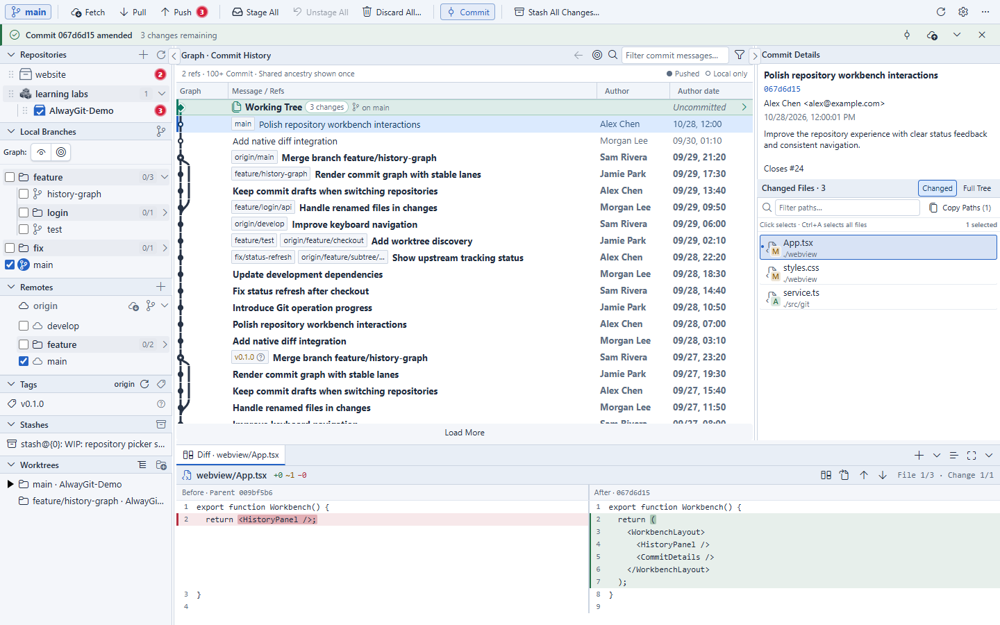

### Discard unwanted Unstaged changes

**Caution:** Discard removes the selected unstaged content. Selected untracked files are deleted from disk. Uncommitted content may have no recoverable Git history, so recovery cannot be guaranteed.

**Prerequisite:** You have confirmed that you do not need the selected changes. Any content you need has been committed, saved in a Stash, or backed up elsewhere.

1. Select the target entries marked Unstaged, right-click, and choose Discard….
2. Read the path list and discard explanation in the confirmation popover, checking each item. If a native VS Code Proceed confirmation follows, check again before continuing.
3. Use Discard All in the unified-mode top toolbar only when you intend to discard every Unstaged change in the repository. The split-mode Unstaged heading action affects the current filter matches. Alternatively, right-click the graph's Working Tree node and choose Discard All Unstaged Changes… without opening the file list. Node actions ignore right-side path filters and selection.
4. After the operation, check the remaining Unstaged and Staged changes to confirm the scope of its effect.

**Result:** The confirmed unstaged changes have been discarded. Content from the same file that was already in the Index should remain intact.

To discard both staged and unstaged content, right-click Working Tree and choose Discard All Changes…. The confirmation explains that the Index is also cleared, tracked content returns to the current commit, and added and untracked files are deleted. The branch and committed history do not move; before the first commit, staged additions are removed and the Index becomes empty. Other ignored files remain. Finish or abort active Git operations and resolve conflicts first. The node also offers Stage All, Unstage All, and Stash All Changes….

Large lists render only rows near the viewport, while filtering and Select All still cover the complete matching range. Discard has no 10,000-file cap; internal batches show progress. If the confirmed scope changes or an operation partly fails, use Recheck Remaining Changes and review the new list before confirming again.

**Troubleshooting:** If you discard something by mistake, stop further writes immediately and check the editor’s local history, backups, or existing Stashes. Do not proceed with Reset or cleanup operations.

## History and Diff Comparisons

Ref checkboxes control which history you see; branch names and row selections control which items you act on. Checking a branch does not switch to that branch.

### Filter history and locate the current version

**Prerequisite:** The repository has at least one commit.

1. In the left pane, check the local or remote branches you want to view. Selecting multiple branches displays the union of their reachable commits. To inspect one Tag separately, open its context menu and choose Show Only This Tag History.
2. Use Show Only This Branch History or Show Only This Tag History to view only the target history. Use Locate Tag Commit in Graph to locate the Commit pointed to by a Tag.
3. Use the presets below Local Branches to quickly show all local branches or only the current branch.
4. When the scope changes, the existing History caption temporarily shows the scope being loaded. A failed read preserves the displayed graph and offers retry in the same row.
5. Use the back arrow before the search field in the Graph heading to restore the previous history view. When a search or file filter is active or the Graph scope is not the current branch, a target icon appears beside it; use that icon to clear searches and tag scopes and locate HEAD on the current branch. Locate HEAD preserves the existing scope. Navigation records last for this workbench session; very deep or outdated history is reread from the first page.

**Result:** History displays a commit graph that matches your selected ref scope.

Scroll near the bottom of the loaded history to fetch more automatically; no load button is needed. Search results and File History also load subsequent records automatically.

Commits appear newest first. An ordinary Merge continues along the receiving branch’s first-parent path, while topic commits occupy a side lane that joins their common ancestor. Commits from both paths remain visible, with each shared ancestor shown once. The default branch’s first-parent path is thicker; side paths retain their color until the junction, and hovering highlights the corresponding lineage. Lanes keep a readable spacing; wide parallel histories scroll horizontally within History.

**Caution:** Working Tree is a virtual node, not a historical Commit. In ordinary history it may appear independently after HEAD is filtered out; file history shows it only for uncommitted changes to the target file and is not counted as an actual history entry.

### Search history and return to full history

**Prerequisite:** Select the branch or Tag scope to query and identify a message, author, code fragment, or Commit ID.

1. Enter a message keyword in History. The query runs after typing pauses. Open advanced history search with the adjacent filter icon.
2. Optionally enter an author name or email, UTC committer date range, repository-relative file or directory, added or removed single-line code, or Commit ID, then select **Apply filters**. Advanced fields remain drafts until applied; applied fields, the message keyword, and the selected refs combine with AND.
3. Review the match count; `+` means more matching commits are available. Queries cover the entire history in the selected scope. Scroll near the bottom to load more matching commits automatically, or use the stop icon to cancel a running query. Applying changed conditions cancels the old request and clears old rows immediately.
4. Select a match to inspect its details. Locate in Full History clears message, advanced, and file-history conditions before locating the commit within the selected refs. Clear advanced filters clears only advanced fields.

**Result:** Conditions match the same commit, and a Merge matching several parents appears once. Conditions persist per repository view and can be restored with Back; existing saved sessions remain compatible. Clearing every search condition restores Graph and the saved column widths.

**Matching rules:** Message and author use case-insensitive literal substrings. Paths identify an exact file or directory scope using `/`; `[]` and `*` remain literal and paths do not automatically follow renames. Dedicated file history keeps its rename tracking and intersects advanced matches. Code examines added or removed lines, using case-sensitive literal matching by default; the regex option uses Git extended regular expressions (ERE). When a path is provided, code must match changes within it; without a path, dedicated file history restricts code to that file identity's historical paths, including rename sources, while ordinary history permits any changed file. Commit ID accepts a unique hexadecimal abbreviation of at least four characters or a full ID resolving to an existing commit. Ref names and commands are not accepted; IDs outside the selected scope produce no results.

**Dates:** Both endpoints include the entire UTC calendar day and filter the committer date. Rows show the author date in the interface's local time zone, so the two may differ. Either endpoint may be omitted.

**Caution:** Search hides Graph because intervening non-matching commits may be absent. Oversized queries fail visibly instead of presenting truncated data as complete. Advanced search limits commit-ID output to 8 MiB; narrow the date, path, or refs and retry. Cancelled or failed queries cannot append rows from an old scope.

**Troubleshooting:** Check applied conditions and ref scope, and clear unrelated conditions before retrying. Invalid dates, reversed ranges, and malformed IDs produce an input error. Unresolvable IDs and invalid regular expressions display the Git query error. Searches do not cover unselected branches.

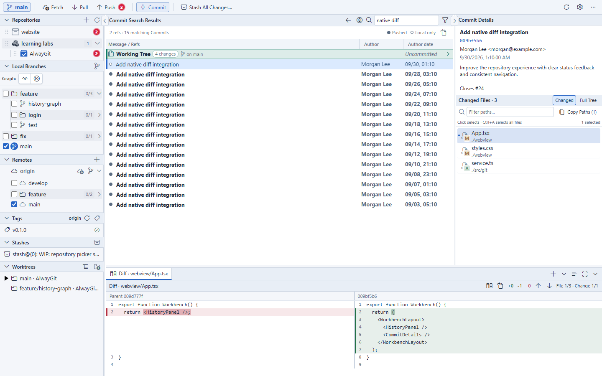

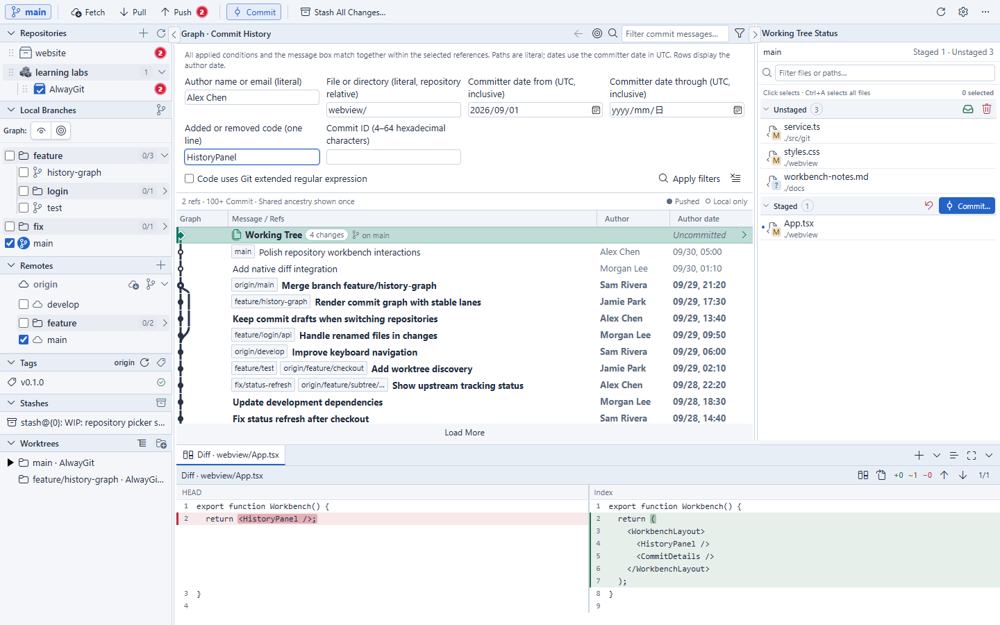

### Inspect commit content and merge parents

**Prerequisite:** The target commit is in the loaded history.

1. Click a Commit row to read its message, author, timestamp, and changed files.
2. Use the file-path filter field to narrow Changed Files. Matching is case-insensitive and uses the full repository-relative path.
3. Click a file to view its Diff. For a Merge Commit, use the Parent selector to choose the parent commit to compare against.
4. To inspect files that this Commit did not change, switch to [Full Tree](#commit-tree).

**Result:** The Diff corresponds to the currently selected Commit, Parent, and file.

**Caution:** Different Parents produce different changed-file diffs. Check the parent before reviewing, especially for a Merge: changes relative to one Parent do not represent every difference between the two branches.

### Browse the full file tree of any commit

1. Switch Commit Details to **Full Tree** to inspect every file saved at that revision, including files this Commit did not change.
2. Expand directories or search repository-relative paths. Click a file to compare its historical version with the same Working Tree path; a missing Working Tree path appears as an empty side.
3. The file menu opens File History or copies the path or object ID. **Open Historical File in VS Code** opens read-only historical text; the bottom **Open File in VS Code** button and E shortcut open the current Working Tree file.

**Result:** Inspect a fixed commit's directories and content without restoring files or checking out a branch. A Merge Commit shows its result tree; check the Commit ID in the heading.

**Caution:** Symbolic links show their target text; Gitlinks show only the submodule object ID. The details tree reports when search reaches its scan limit. See [Git LFS](#git-lfs) for missing LFS objects.

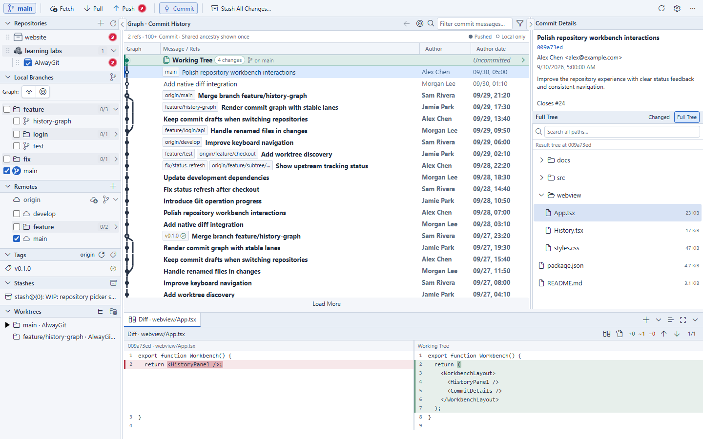

For a separate directory view, right-click a Commit and choose **Browse Commit Tree** to open its snapshot in an independent tab. Choose a list, horizontal, radial, or vertical view and optionally show changes relative to a parent. **Show changes only** retains changed files and their necessary directories; click it again to restore saved folder expansion preferences. Clicking a file shows that revision's content, or its Diff when marked as changed. This auxiliary view does not check out a branch or modify the Working Tree.

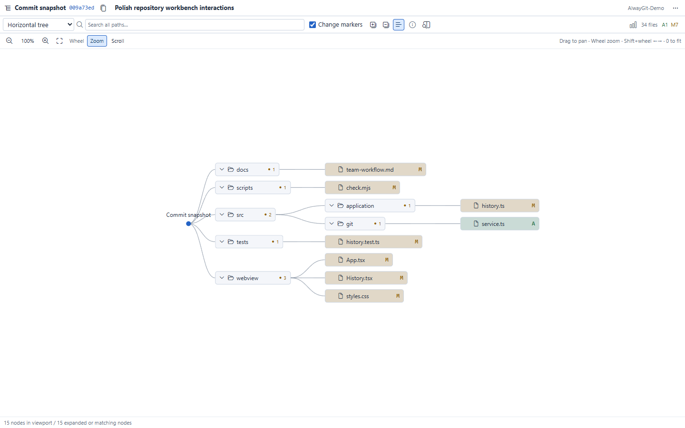

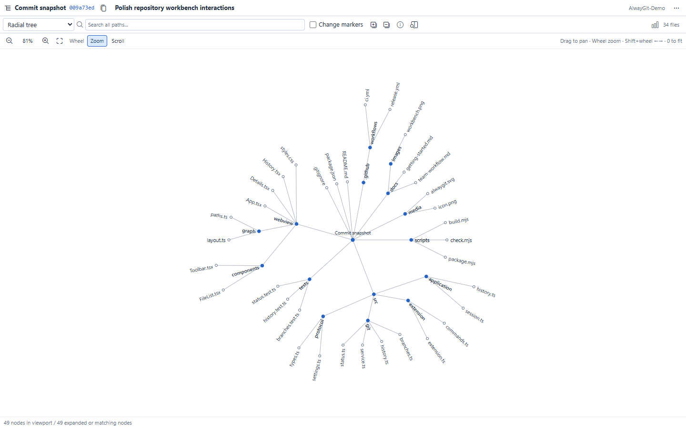

### Compare two commits

**Prerequisite:** You know which two versions you want to compare, and both are loaded.

1. Click the first Commit, then Ctrl/Cmd-click the second so that exactly two commits are selected.
2. The right pane automatically switches to Compare Commits. Check the commits on the left and right. If one is an ancestor of the other, the ancestor appears on the left; otherwise, selection order is used.
3. Click a changed file to view its Diff. Click the swap button when you want to reverse how additions and deletions are shown.
4. Deselect commits until only one remains to return to single-commit details.

**Result:** The changed-file list and bottom Diff pane show the changes between the two versions.

**Caution:** Selecting three or more commits returns to the details of the last commit you interacted with, while retaining the multiple selection for batch actions. It does not compare several versions at once.

Use **View file tree differences** to inspect the target revision’s full directory tree and changes in a separate tab. Check the base and target: additions, deletions, and modifications follow that direction.

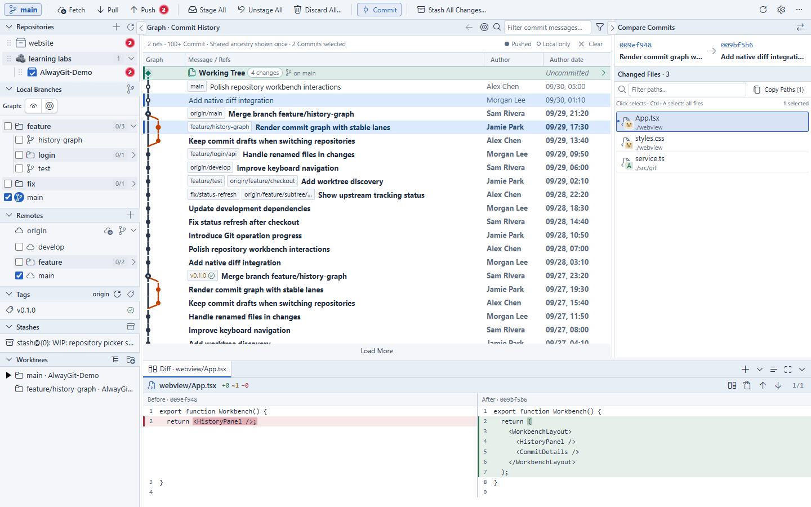

### Compare branches without checkout

1. Right-click a local or remote branch and choose **Compare with Current Branch**. Select the base and target branches in the dialog; neither selection checks out a branch.
2. The default review mode shows the target's changes since the common ancestor. Choose **Endpoint snapshots** to compare the two branch tips directly. The reverse button swaps the pinned endpoints and recomputes the review direction.
3. Both sides show their exclusive commit counts and paginated commit lists. Click a commit to inspect its files and Diff; use the back arrow to return to branch changes. Filter changed files by path and select a file to use the same text, image, and binary preview as the workbench.
4. The endpoint object IDs stay fixed when reading files, changing mode, paging, or reversing direction. When a branch moves or disappears, the dialog shows an update indicator. Use its refresh button to resolve the selected references again; it does not Fetch.

If no common ancestor exists, review mode explains why it cannot show files; endpoint snapshots remain available. If there are several common ancestors, select one explicitly or use endpoint snapshots. Closing the dialog preserves the graph, File History, working selection, and commit drafts. Comparison selections are local to the open dialog.

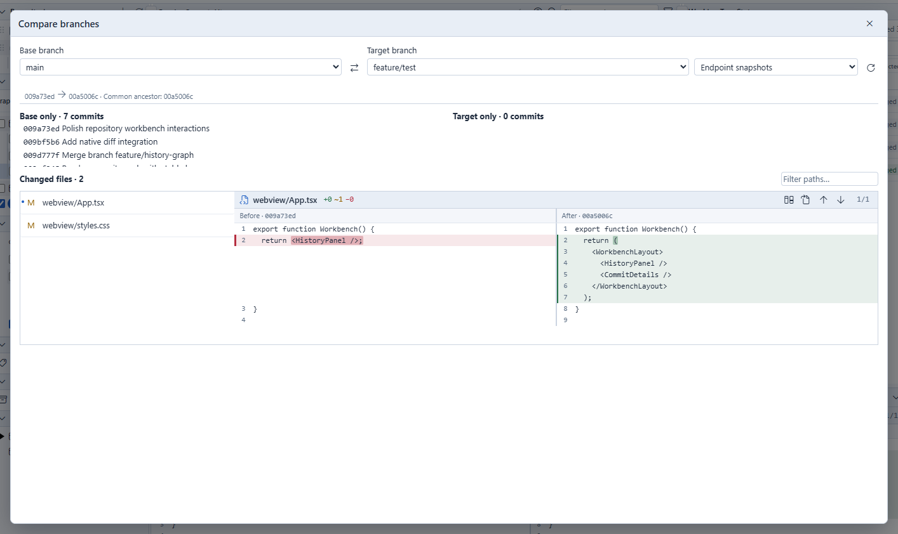

### Read and navigate diffs

**Prerequisite:** The target file is open in the bottom Diff pane.

1. A file icon and bold relative path identify the current file, with compact added, modified, and deleted block counts beside it. Original icon buttons remain on the right in Previous, Next, current-position order; the position is borderless readonly text. Historical Commits default to “File 2/5 · Change 1/3”, showing the file position and the block position within that file. Side labels read “Before · source” and “After · source”; historical sources use short hashes, while working-directory comparisons retain names such as HEAD and Index.
2. Previous and Next follow the current Commit's changed-file order by default. Next enters the first block of the next file; Previous enters the last block of the previous file. At the Commit's first or last block, the first out-of-range action shows a notice and keeps the current position; run the same action again to wrap. The notice floats above the code without shrinking the viewport or changing the reading position. Merge Commits keep the selected Parent, and navigation stays in the same Commit.
3. To browse one file, open Settings → Interface → Diff, change “Diff navigation scope” to “Current file”, and Apply. This mode shows current / total blocks and uses the same notice-then-repeat behavior at the file boundaries; with only one block, either button locates it again immediately. The preference is saved in user settings and shared across windows.
4. Text wraps to the reading area by default while line numbers still refer to the original file. Settings → Interface → Diff offers a fixed wrap width or no wrapping; oversized content can scroll horizontally. Check the comparison title after switching files.

Red marks deletions and green marks additions; stronger inline emphasis identifies changed text. Copying source excludes line numbers and does not insert the visual line wraps.

**Result:** Choose to inspect the entire Commit or the current file block by block. Adjacent changed lines form one contiguous block.

**Caution:** Entire Commit includes files hidden by the path filter. The Diff title shows the actual path, and the file list identifies a hidden current file. Binary files and files without text change blocks are skipped but remain available for manual inspection. Read failures stop navigation and show an error. Text statistics and navigation cover the complete file, including changes after line 4000. Scroll to inspect all context. Resource limits produce an error rather than a partial comparison or a misleading zero-change count. Working Tree, Stash, and Commit comparisons navigate within the current file, using the same notice-then-repeat boundary rule and immediate relocation for a single block.

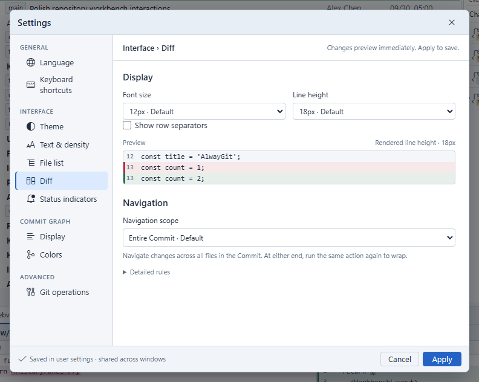

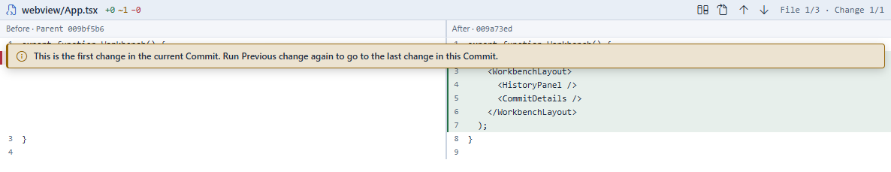

### View a file’s commit history

1. Right-click one file in Working Tree, Commit Details, or a two-Commit comparison and choose Show File History. One file is supported at a time; staged and unstaged entries for the same pathname share the entry.
2. History keeps the currently checked references and shows only commits related to that file. The path bar identifies the file and ref scope. Its branch icon expands the scope to all local and remote-tracking branches. Remote history uses locally known refs; Fetch first for new remote records.
3. Select a Commit to retain its complete changed-file list and automatically open the target file’s Diff. Older commits use the pathname at that revision. Merges default to a real Parent that exposes the file change, and you can still select another Parent.
4. Close the file filter with the path bar’s close icon, or use Back to restore the previous filters, selection, and reading position. Locate in full history exits the file filter and locates the selected Commit. Reopening the workbench restores the file filter per repository.

Entering file history clears an existing commit-message search and saves it in the Back record. You can then search within the file history. Pagination queries matching records from Git history beyond the commits previously loaded. Dashed edges skip unrelated intermediate commits and do not imply direct parent relationships.

Git similarity detection identifies renames, traced independently along each merge Parent. Deleted files remain inspectable; a same-name file recreated after deletion starts a separate history. Ordinary copies start a new file. Working Tree appears only when the target has uncommitted changes; its file list and split group actions use that file scope. Unified toolbar bulk actions and ordinary Commit retain their complete-repository scope. Missing records show an empty state; exceeded read limits produce an error, allowing a narrower branch scope and retry.

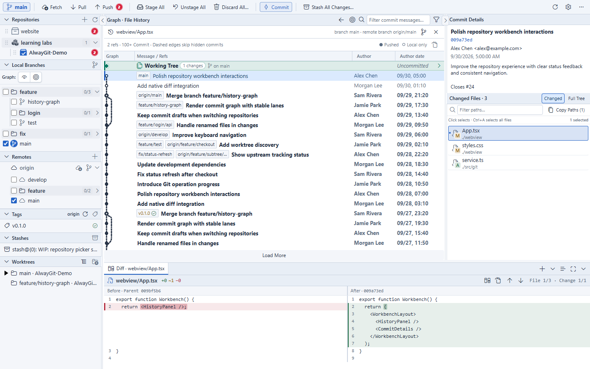

### Recover a commit with Reflog

Open More → Open Reflog to inspect the current worktree HEAD or a local branch. Select a record, inspect its commit and choose a file for an independent Diff. Closing the dialog preserves your original history, file selection and drafts. Refresh reads recent records; pagination stays within one snapshot.

To recover a commit from before a Reset or Rebase, select its record, enter a recovery branch name and choose Create recovery branch. Your current branch and worktree remain selected unless you explicitly check the switch option. Expired records or pruned objects may be unavailable. Reflog does not save discarded uncommitted file contents.

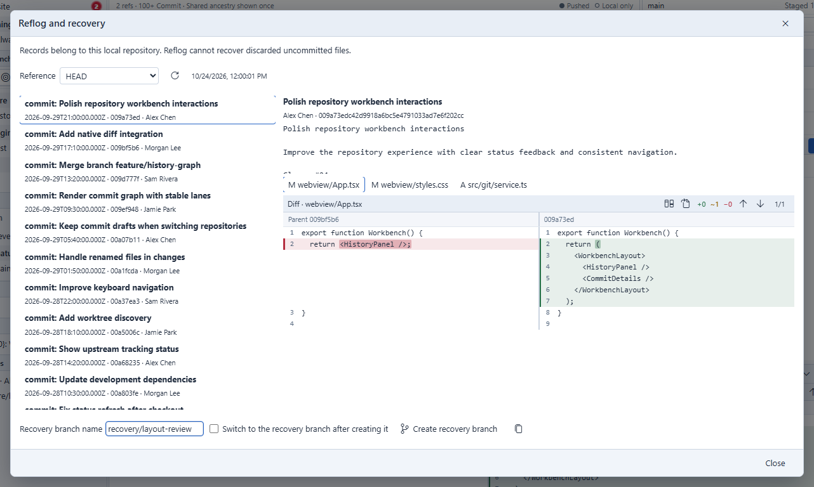

## Branches and Historical Versions

A branch is a movable reference to a version. Creating a branch, switching branches, and filtering branch history are three separate actions. Read the button label before acting and the completion feedback afterward.

### Create a branch, with or without switching to it

**Prerequisite:** Confirm the starting point and safely save any changes in your working directory.

1. Click Create Branch… in the Local Branches header. You can also right-click a specific branch, Tag, or Commit to create a branch from that fixed starting point.
2. Check the starting point shown in the dialog and enter a new branch name, such as feature/guide.
3. Resolve any name warnings. Duplicate names, invalid names, and parent/child path conflicts require a different name before you can proceed.
4. Choose Create Only to create just the reference, or Create and Checkout to start working on the new branch.
5. Read the completion feedback and check the current-branch indicator to confirm whether you actually switched branches.

**Result:** The new branch has been created, and whether you switched to it matches the action you selected.

**Caution:** For example, if feature/readme already exists, you cannot create feature. Likewise, if feature already exists, you cannot create feature/readme.

**Troubleshooting:** If creation succeeds but changes block Checkout, the new branch may already exist. Check the feedback first rather than blindly trying to create another branch with the same name.

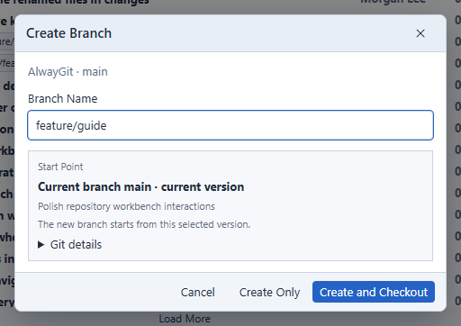

### Switch to a local branch and handle a blocked checkout

**Prerequisite:** The target is not the current branch and is not in use by another Worktree.

1. Double-click the target local branch, or right-click it and choose Checkout….
   During execution, the workbench shows its own centered progress dialog. Background actions and shortcuts stay locked until the result is synchronized.
2. If a warning says that changes could be overwritten, review the affected files rather than discarding them immediately.
3. Depending on your goal, Commit first, Stash first, or use Stash Changes & Checkout if that option is explicitly offered.
4. After switching, check the current-branch triangle and the file status in Working Tree.

**Result:** The current branch has changed, the working directory matches the target version, and any changes you need to keep are still safely stored.

**Caution:** A branch in use by another Worktree cannot be checked out directly in the current directory. You can open the Worktree identified in the message instead.

**Troubleshooting:** If there are conflicts or an operation is in progress, complete it or use Abort first. A single click on a branch name only navigates to it; it does not mean that Checkout has run.

### Create a local tracking branch from a remote branch

**Prerequisite:** You have run Fetch, and the remote reference is at the latest state you want to use.

1. Double-click the remote branch, or right-click it and choose Checkout as Local Branch….
2. Check the remote source and local branch name. By default, the remote prefix is removed and the directory structure is preserved.
3. If the correct tracking branch already exists, choose to reuse it. If a branch with the same name has a conflicting upstream, or there is a path conflict, change the name first.
4. Leave the Checkout option selected or clear it as needed, then confirm creation or reuse.
5. To prepare multiple tracking branches at once, use Create Local Tracking Branches… on the same Remote or directory and check the result for each branch.

**Result:** The local branch tracks the correct remote source. Batch creation leaves the current branch unchanged.

**Caution:** This action does not automatically run Fetch or Pull. Symbolic references such as origin/HEAD are not targets that can be turned into ordinary local branches.

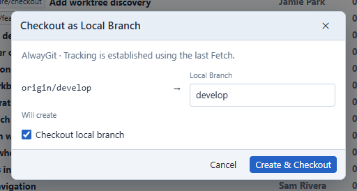

### Delete a local branch you no longer need

**Prerequisite:** Confirm that the branch is no longer needed and that any important commits are retained by another branch or backup reference.

1. Right-click a local branch other than the current branch and choose Delete Branch….
2. Check the branch name and warning. If you are unsure whether it contains unique commits, cancel and inspect the history first. Configure the initial force choice in Settings → Advanced → Git Operations, or override it for this operation. Select Remember this selection as the default to save either on or off after at least one deletion succeeds. The dialog shows the user or workspace scope; cancellation or total failure does not save, and a preference write failure is reported separately.
3. After confirming, check the branch list and the current branch.

**Result:** The target local branch reference has been removed, and the current branch remains clearly identified.

**Caution:** Restrictions apply to the current branch and branches in use by other Worktrees. Deleting a remote branch is a separate action that affects collaborators.

### Inspect an older version safely

**Prerequisite:** Your target is an older Commit, and you do not intend to work directly without a branch.

1. Double-click the older Commit, or choose Create Branch and Checkout… from its Commit context menu.
2. If a local branch already points directly to the target, select that branch when prompted. Otherwise, enter a new branch name.
3. Check the fixed starting point, create and switch to the branch, then inspect the files.

**Result:** You are inspecting the older version on a named branch, so subsequent commits have a clearly identified branch to belong to.

**Caution:** Direct Detached HEAD Checkout is disabled by default. The Commit context menu shows this action disabled with an explanation to create a branch. At a local branch tip, the Commit menu names that branch or asks you to select one. If you deliberately enable the advanced option, you must still create a branch to retain any new commits made afterward. The original branch reference does not automatically move with them.

**Troubleshooting:** If you discover that you are already in Detached HEAD, create a branch for any new commits you need to keep before switching back to the original branch.

## Remote Collaboration

Fetch updates your local knowledge of the remote state. Pull integrates remote changes into the current branch. Push sends local commits to the target remote. Distinguish these three actions first, then check the source and destination.

For large transfers that need more time, search VS Code settings for `alwaygit.networkTimeoutMinutes` to adjust the network command deadline. See the [workbench specification](WORKBENCH_SPEC.md) for values and scope.

### Add a remote

**Prerequisite:** Obtain the correct remote repository URL or local Git remote path, and prepare the authentication method required by any online service.

1. Click the Add Remote… plus button in the Remotes header, or use the right-click entry with the same name.
2. Enter a name, such as origin, in Remote Name and your own remote address in Repository URL. The example placeholder address is not an actual repository. Confirm that the target belongs to the intended project, then click Add Remote.
3. After adding it, check Remotes and run Fetch to retrieve references if necessary.

**Result:** The remote appears in the navigation and remote branches can be fetched.

**Caution:** Do not put access tokens or passwords in descriptions, commit messages, screenshots, or untrusted URLs.

**Troubleshooting:** If authentication fails, use the authentication flows supported by the hosting service and VS Code. Do not repeatedly change repository contents as a way of troubleshooting.

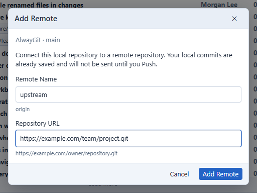

### Fetch remote updates and pull changes

**Prerequisite:** A remote is connected. Before running Pull, confirm the current branch and the state of local changes.

1. Run Fetch for the target Remote and wait for the results bar to report success.
2. Inspect the remote branches and history differences to understand the commits you are about to integrate.
3. Use Pull to update the current branch. Check the source branch → current local branch shown under Pull source. The upstream source is selected by default; the Change pull source icon opens remote and source branch selection, including an input for branches not yet fetched. Without an upstream, select the source explicitly. This choice applies only to this Pull and does not change upstream configuration. Choose your collaboration strategy in Pull Strategy; use Fast-forward Only when only fast-forward updates are allowed. Add a remote first if none exists, and switch to a local branch before pulling from Detached HEAD. With a complete source, Pull receives initial focus so Enter runs it immediately; otherwise focus moves to the field requiring input.
4. After success, inspect the history. If conflicts occur, complete or abort the operation as described in “Merging and Resolving Conflicts.”

**Result:** Fetch updates references for the fetched remote and prunes remote-tracking branches deleted there. The Remote list and Graph refresh together, and checked or selected references that no longer exist are cleared. Local branches with the same names, unpushed commits, working tree contents, and staged changes are preserved. After Pull, the current branch has integrated the target changes or has clearly entered a state requiring further action.

**Caution:** Without an explicit Remote, Fetch uses Git's default remote selection; with a Remote, it fetches only that target. Fetch disables automatic `pruneTags` cleanup and preserves ordinary local tags; explicit tag refspecs or mirror configurations still determine their own pruning scope. The Graph status indicating that a commit is already on the remote is based on the remote references known locally after the most recent Fetch. It is not a live query of the server.

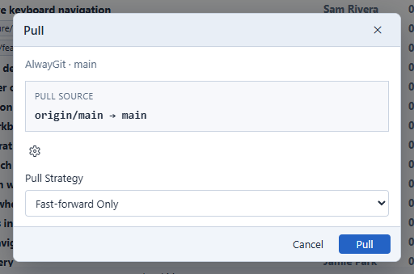

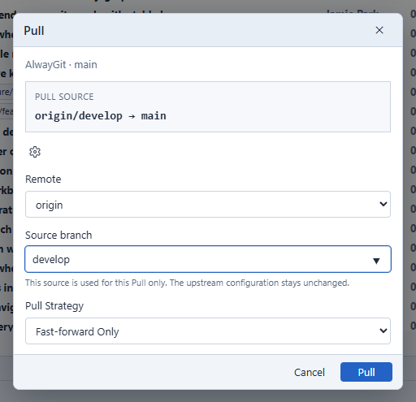

### Push local commits

**Prerequisite:** You are on a clearly identified local branch, and the commits to send have been reviewed.

1. Click Push and read the actual Local Branch → Remote/Remote Branch mapping.
2. If no remote exists, follow the instructions to Add Remote… and finish connecting it, then return to Push.
3. On the first Push, note the information about setting up upstream tracking. If there are multiple remotes and the target cannot be determined, explicitly select the remote.
4. To change the destination, use Change Target… and check the source, remote, and target branch again.
5. With a complete target, Push receives initial focus so Enter runs it immediately. Otherwise focus moves to the missing target field or Add Remote when no remote exists. Wait for success feedback and check that the unpushed count has updated to reflect the actual state.
6. The result bar starts as one line with status, a summary, and action icons. Expand Operation details to see each destination's publication or update status, remote links with open/copy icons, and full output. Check each destination before retrying a partial Push.
7. On GitHub/GitLab, use the result or branch context menu to start a PR/MR. Without a server-provided link, confirm the target repository and branch in the AlwayGit frontend dialog, then finish on the website. GitHub supports selecting the upstream repository for a fork; GitLab forks require a server-provided MR link. The shortcut does not submit a request or query existing PR/CI status. Pushed GitHub tags also offer a release creation shortcut.

**Result:** The target remote branch has received the intended commits, or a clear reason for failure is shown.

**Caution:** The Push badge shows the number of unpushed commits, not the number of errors. The toolbar Push action is unavailable in Detached HEAD. A normal Push sends only the branch by default and explicitly uses `--no-follow-tags`, so it does not inherit the machine's `push.followTags` configuration. To include annotated Tags that point into the pushed history, enable “Push related annotated Tags” under Advanced options. You can use that choice once or select “Remember as default” to persist it in Settings. Lightweight Tags and unrelated Tags still require the explicit Tag Push action.

**Troubleshooting:** If the push is rejected, run Fetch first and check for diverging histories, authentication issues, and permission problems. Do not treat Force-with-lease as a routine retry.

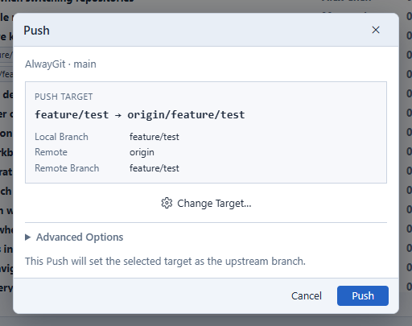

### Use Force-with-lease cautiously

Force-with-lease is in the advanced Push options and is intended for situations where you have already decided to rewrite remote history. It provides protection only when the remote has not undergone changes unknown to you; it does not mean that others will be unaffected. Before using it, confirm with your collaborators, keep backup references, and understand the history you will replace. If you are unsure, cancel, then Fetch and compare first.

### Delete remote branches

`Delete Branch from <remote>…` for a remote branch changes a reference on the server. Whether deleting one branch or multiple branches selected under the same Remote, check the remote and branch list item by item and read the second confirmation. If only some deletions fail, handle each result individually. Symbolic references such as origin/HEAD cannot be deleted as ordinary branches.

## Temporarily Saving and Restoring Changes

Stash temporarily saves changes that have not yet been committed. It is entirely different from Stage: Stage prepares changes for a commit, while Stash saves them and clears them from the working directory. When restoring, use Apply first to keep the original entry, then decide whether to delete it after checking the result.

### Save all changes

**Prerequisite:** You want to set aside your current work temporarily and know whether you need to include untracked files.

1. Use Stash All Changes… in the top toolbar or the Stashes header.
2. Enter a description that will help you identify the entry, and select the option to include untracked files if needed.
3. Confirm the scope to save, then run the action. Read the number of files saved, the number of untracked files, and the post-operation status.
4. Find the new entry under Stashes and inspect its contents.

**Result:** The selected scope has been saved as a Stash, and the working-directory state matches the feedback.

**Caution:** Include untracked files does not include files ignored by .gitignore. When it is not selected, ordinary untracked files are not saved either. Stash is not a substitute for a full project backup.

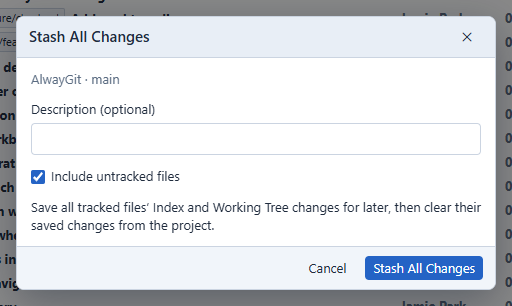

### Save only selected files

**Prerequisite:** Use Git 2.43 or later. You want to temporarily save and set aside certain whole files while leaving other files unchanged.

1. Select the target files in Working Tree. You can select files across Staged and Unstaged.
2. Right-click the selected files and choose Stash Selected Files….
3. Check the deduplicated file count, full paths, and description, then confirm to save.
4. Verify that unselected files remain unchanged and inspect the file categories in the new Stash.

**Result:** The explicitly selected files have been saved in full, with each file counted only once. Unselected files should not have been cleared along with them.

**Caution:** Even if you select a file from the Staged side, the file's complete Index and Working Tree state is saved, not just the side you are viewing.

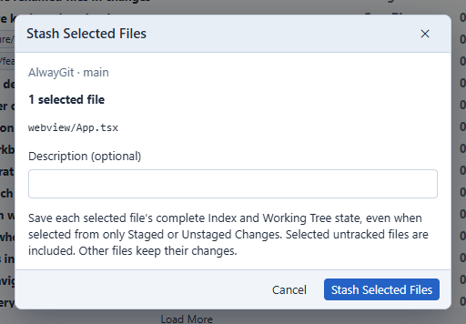

### Inspect and restore a Stash

**Prerequisite:** Use Git 2.43 or later and confirm that the current repository and branch are correct. Check and safely save any other work first. A clean working state is recommended for restoration.

1. Right-click the Stash and choose View Changes. Use the tabs that actually appear to inspect the Working Tree, Index, and Untracked Files categories and counts.
2. Prefer Apply Stash to retain the original entry after restoration. Choose Pop Stash only if you specifically want the entry deleted after a successful restoration.
3. In the confirmation dialog, check the Stash description and target repository, then click Apply Stash or Pop Stash.
4. If preflight passes, wait for the restoration result and check how the changes are distributed between Staged and Unstaged.
5. Confirm that the file contents are correct, then decide whether to delete the Stash if it is no longer needed.

**Result:** The saved file state has been restored to the current working directory. Apply retains the entry; Pop deletes it only after success.

**Caution:** Restoration attempts to preserve the original Index state. Do not treat Stash as a remote backup; entries belong to the local repository.

**Troubleshooting:** If a message explains that restoration is blocked, resolve the occupied paths or conflicts first, then close the dialog and try again to trigger a new preflight.

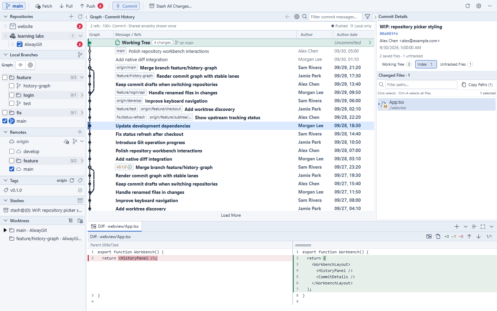

### Handle a blocked Stash restoration

**Prerequisite:** Apply or Pop reports that it cannot restore safely.

1. Read the reason for the block and Git details. Show Log contains the same underlying diagnosis. “Conflicting files” identifies confirmed conflicts; “Files involved in restoration” describes the saved content and does not identify which files blocked restoration.
2. Use the comparison entry point to compare the contents saved in the Stash with the current files. Open the current files if necessary.
3. Check other currently Staged and Unstaged files. If necessary, Commit them, save another Stash, or make a reliable backup to provide a clean working state for restoration. Do not discard existing contents just to retry.
4. After resolving the block, close the dialog, select the Stash again, and run the restoration.

**Result:** The prerequisites for restoration have been clarified, or you have safely stopped the restoration and retained the original Stash.

**Caution:** A preflight block stops the entire restoration. If new external changes or write errors occur after actual execution begins, do not assume that the working state is necessarily completely unchanged. Always inspect the actual result.

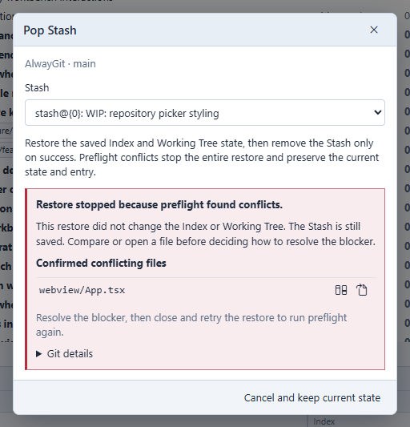

This is the older blocked-restoration dialog. The current version distinguishes confirmed conflicting files from files involved in restoration, and Git details provides the specific diagnosis.

### Delete a Stash you no longer need

**Caution:** Drop has no standard undo, so confirm first that you no longer need to retain the saved contents. Do not identify an entry solely by its stash number before deleting it; other save or delete actions may change the numbering.

**Prerequisite:** Confirm that the contents do not need to be restored, or that they have already been fully restored and checked.

1. Right-click the target Stash and choose Drop Stash….
2. Check the entry's description and identity, then confirm deletion.

**Result:** The target entry has been removed from the Stashes list.

### Support limits for isolated Stash restoration

Saving a selected-files Stash and isolated Apply / Pop restoration require Git 2.43+. Sparse checkout, affected submodules, active external filters, custom or default external merge drivers, unsupported file types, and other conditions may prevent the working state from being reproduced accurately and block the operation. A single file exceeding 32 MiB or local snapshots exceeding 128 MiB in total will also stop the operation. Working-state checks may be affected by files that were not selected.

These are the limits of AlwayGit's isolated trial, not the full capabilities of Git Stash. If you encounter a limit, preserve your existing changes and Stash first, then follow the specific guidance. Do not discard contents simply to bypass the protection.

## Merging and Resolving Conflicts

The goal of conflict resolution is to produce the correct final file contents. Marking a file as resolved and staging it only tells Git that the file has been handled; it does not determine whether the result is logically correct.

### Merge another branch into the current branch

**Prerequisite:** Switch to the target branch that will receive the changes. Save any current changes and create a backup branch if necessary.

1. Confirm that the current branch is the one that will receive the merge.
2. Right-click the local or remote branch providing the changes and choose Merge….
3. In the dialog, check the source and the current target branch again, then confirm the merge.
4. If it succeeds, inspect the history. If conflicts occur, follow the conflict-resolution workflow below rather than starting Merge again.

**Result:** The merge has succeeded or has clearly entered an in-progress state. The results bar explains the actual outcome.

**Caution:** The branch you right-click is the merge source. The current branch is the target that will be updated.

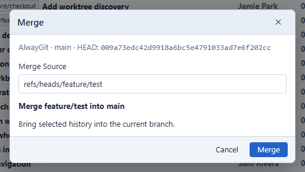

### Resolve conflicts manually

**Prerequisite:** The workbench shows an in-progress Git operation, or there are files under Conflicts.

1. Click the control for viewing conflicts in the operation bar to go to Working Tree and locate the conflicted files.
2. Ours / Theirs at the bottom is a read-only comparison. Click the pencil beside a conflicted file to open it in VS Code, understand the changes on both sides, and edit the file into the complete result you want to keep.
3. Remove any conflict markers that should not remain and save the file. Check related files and run the project's own validation if necessary.
4. Return to AlwayGit, select the conflicted files you have finished handling, and use Manually handled: Mark & Stage. When no individual file is selected, the All button handles all conflicted files.
5. Check Staged Diff to confirm that the staged content is the result you just saved. Repeat for the other conflicted files.

**Result:** Git has no remaining unmerged entries and the operation bar indicates that the result is ready for review. You must still manually confirm that the contents are correct.

**Caution:** Do not confuse ordinary Stage with marking a conflict as handled and staging it. After saving the contents in the editor, you must stage them again to update the Index.

**Troubleshooting:** If you chose the wrong contents, continue editing, save, then stage again and review. Do not treat a conflict count of zero as proof that validation passed. If the native editing flow prompts you to Trust the project workspace, follow Chapter 11 to handle the trust status of the target window.

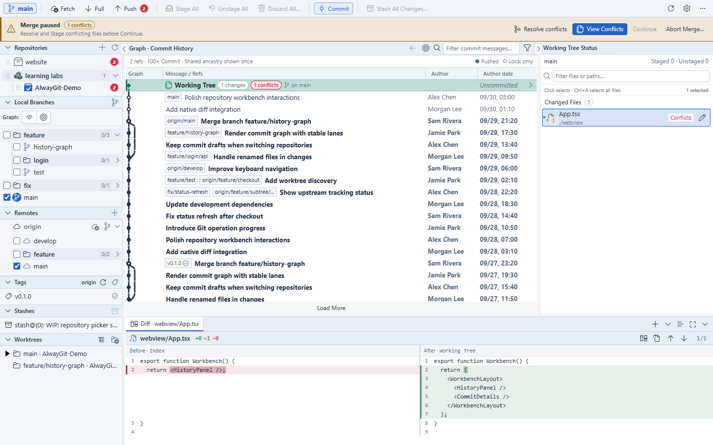

### Review the staged result and continue

**Prerequisite:** All conflicts have been handled as intended and the Staged result has been reviewed.

1. Click Continue or use the ordinary Commit action while the operation is active.
2. Read the staged-content review list, checking the locations of suspected conflict markers and any files that were not scanned.
3. If you find a problem, return to review. Inspect it in the staged Diff and use the editing entry point to correct the file. Save your changes and Stage them again.
4. If the review finds no problems, click Confirm & Continue.
5. If there are suspected markers or unscanned files, select the required acknowledgment and use the option to continue anyway only after explicitly checking them. Otherwise, choose Return to Review.
6. When the operation finishes, confirm that the active operation bar has disappeared, then check the history and Working Tree.

**Result:** The in-progress operation has actually finished, and you have reviewed the resulting contents.

**Caution:** The review has limits involving size, binary files, encoding, and submodules. An absence of suspected markers does not guarantee semantic correctness. Changes to the Index or branch after the review require another review. Skip appears only when the current Git operation supports it and discards the current commit and its conflict-resolution changes. Switching repositories, restarting the operation, or advancing a step invalidates an old confirmation; review the current step and confirm again.

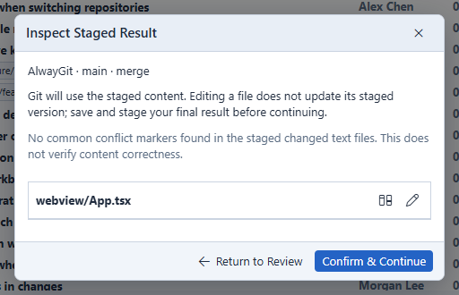

### Abort an in-progress operation

**Prerequisite:** Confirm that you no longer want to continue this Merge, Rebase, Cherry-pick, or Revert.

1. Choose Abort or the option to abort the current operation in the persistent operation bar or the operation dialog.
2. Read the starting commit and the recovery information. If you need to keep your manual resolution work, make a reliable backup first.
3. Proceed through the workbench explanation and native confirmation, then check the current branch, history, and file status.

**Result:** Git has attempted to restore the state from before the operation began, and the in-progress indicator has disappeared.

**Caution:** Closing the operation window only closes the window; it does not abort the Git operation. Abort may discard changes made while resolving conflicts. Changes that existed before the operation may affect whether full restoration is possible.

**Troubleshooting:** If Abort fails, stop repeating write operations, retain the error information, and inspect the actual Git state before taking further action.

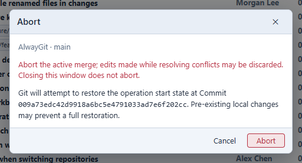

## Organizing Commit History

Use the operations in this chapter only after you understand the relationships in the history. Before proceeding, record the current branch and commit, create a backup branch, and resolve or save any uncommitted changes. For history that has already been shared, prefer corrections made through new commits that can be reviewed.

### Create, push, and delete Tags

**Prerequisite:** Identify the version you want to tag.

1. Right-click the target Commit or branch and choose Create Tag…, or use the entry point in the Tags heading. A Commit-row action is fixed to the row you right-clicked; the Tags heading action does not reuse HEAD or the Graph selection.
2. Enter a name, such as v1.1.0, in Tag Name. From the Tags heading, Target Commit starts empty: enter a Commit ID and verify the resolved Commit Message. From a Commit row, Target Commit is read-only and shows that Commit's ID and Message. Fill in Annotation if needed. To publish immediately, enable “Push this Tag after creation” and select a Remote; use it once or remember it as the default.
3. Check the new tag under Tags. Clicking its name selects the action target without changing the current Commit, Diff, or history scope. Double-click or focus the name and press Enter to locate its commit; Space only selects. You can also use Locate Tag Commit in Graph or Show Only This Tag History. If the target is outside the current Graph, locating shows that Tag's history; history Back restores the previous view. Locating does not Checkout.
4. To publish tags, right-click one or more Tags, choose Push Tag… or Push N Tags…, then verify the complete Tag list and Remote.
5. To delete a local tag, right-click the target Tag and choose Delete Tag…. It deletes only the local Tag by default. To delete the matching Tag from the selected Remote too, enable “Also delete from a remote,” then verify the Remote, warning, and confirmation list.
6. For a remote-only Tag marked with a cloud icon, right-click it and choose Delete Remote Tag…. This deletes the confirmed remote object without creating or deleting a local Tag.

**Result:** The local Tag points to the specified version, the explicitly selected Tags are published to the Remote, or the target Tag is removed locally, remotely, or from both locations as explicitly selected.

**Caution:** Create-and-push keeps the local Tag first; if the remote push fails, retry later with Push Tag. Tag Push sends only the Tags listed in the dialog, supports lightweight and annotated Tags, does not include other local Tags, and does not overwrite a differently identified remote Tag with the same name. Delete Tag still deletes only locally by default. Remote deletion must be explicitly enabled or opened from a remote-only Tag, followed by native confirmation. Before execution, AlwayGit verifies the remote Tag identity and destination; deletion is unavailable when read and push addresses differ or multiple push addresses exist. A combined deletion removes the remote first and retains the local Tag if that remote step fails. Remote Tag replacement is not provided.

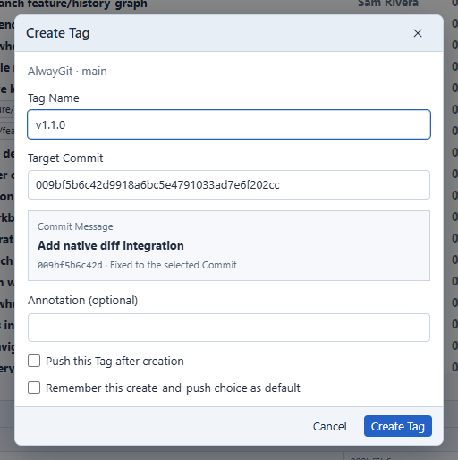

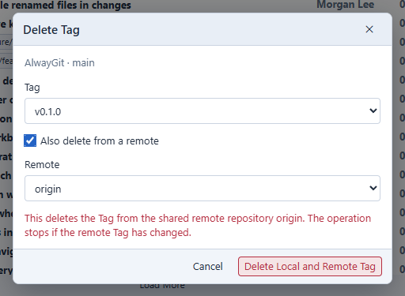

### Check local and remote Tag status

For local Tag names, Ctrl/Cmd-click toggles one item, Shift-click selects a range, and Ctrl/Cmd+Shift-click adds a range. Ctrl/Cmd+A selects all local Tags in the list; Escape clears Tag selection. Right-clicking a selected Tag preserves the selection; right-clicking an unselected Tag selects it alone. Remote-only Tags support single selection and individual context actions, and are excluded from local Tag batch menus. Changing the comparison remote clears remote-only selection. Local Tags pointing to non-Commit objects can be selected and opened with a context menu, but cannot locate commits; clicking their names does not open a menu.

Tags combines local Tags with Tags that exist only on the selected remote. The remote name in its header identifies the comparison target; choose another remote when available, with the selection remembered per repository. Each row shows only a status icon: a green check means Synced, a desktop means Local only, a cloud means Remote only, a warning means the same name identifies different objects, and a question mark means no query has succeeded yet. Hover, focus or click for the full meaning. A remote-only object is not yet a local ref and cannot be located in local history. Results do not expire with time and change only after another successful query; a failed query preserves the previous successful result. With no configured remote, Tags show Local. Local Tag labels in the commit graph use the same status icons; the commit node's Pushed indicator still describes availability on known remote branches.

Hover or focus the status for details and the last successful check time, or click a list status to open its details. The header refresh icon and Check remote Tag status context action perform a read-only query. The first Tags expansion, switching remotes and completing Fetch/Pull/Push refresh the status as needed; ordinary local refreshes reuse the existing result. Queries do not block local history, and a failure neither means a Tag is absent nor replaces the previous result. Status describes the selected remote's read address; differing read and push addresses are explicitly identified, so a successful push does not prove availability at a different read address.

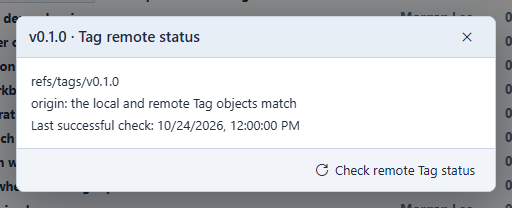

### Apply a specific commit to the current branch

**Prerequisite:** The current branch is the receiving branch, the working directory is ready, and you understand the target commit's contents and dependencies.

1. Switch to the branch that should receive the changes.
2. In History, right-click the ordinary Commit you want to apply and choose `Cherry-pick to <current branch>`, for example, Cherry-pick to main.
3. For a Merge Commit, perform the operation separately and choose Mainline Parent. First understand which parent the changes will be taken relative to.
4. For a batch operation, explicitly select the actual Commits you need, then run the batch Cherry-pick. Commits are applied from oldest to newest in topological order.
5. After success, check the new commits. If a conflict occurs, resolve it and Continue, or Abort.

**Result:** The target changes have been added to the current branch as new commits, or the operation is explicitly paused and awaiting resolution.

**Caution:** Ordinary Cherry-pick is disabled for the current HEAD and commits already in the current branch history, with an explanation. A batch containing any such commit is disabled as a whole; deselect those commits first. Other ordinary Commits can execute immediately after ancestry checks pass, so verify the target before clicking. Batch Cherry-pick is not supported for a selection that includes a Merge Commit. If changes from a historical commit were reverted or removed, use `Reapply Historical Commits…` and explicitly check the confirmation before submitting. This entry is unavailable for the current HEAD, and reapplication can still produce conflicts or an empty result.

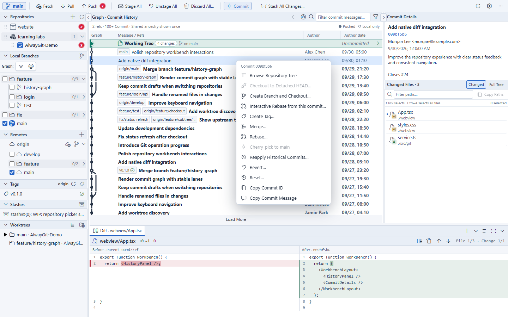

### Use Revert to undo an ordinary commit

**Prerequisite:** The target is an ordinary Commit, and you want to preserve the existing history while undoing the target's effects in a new commit.

1. Switch to the branch you want to correct and check that the target Commit belongs to the relevant history.
2. Right-click the target Commit and choose Revert….
3. Verify the target and the confirmation message, then proceed. If a conflict occurs, resolve it manually and check the staged result.
4. When finished, review the new revert commit and the file contents.

**Result:** A new commit undoes the target's effects, while the original commit remains in the history.

**Caution:** Revert is not the same as restoring the entire repository directly to that commit, and it does not guarantee automatic compatibility with later changes. For a Merge Commit, you must specify Mainline Parent. If you do not understand the parent versions, cancel first to avoid undoing the wrong set of changes.

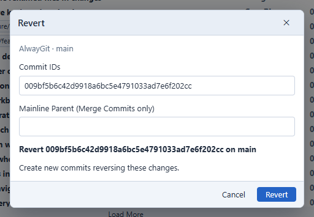

### Reset the current branch to a specific commit

**Caution:** Hard can discard uncommitted content. Resetting shared history affects collaboration; do not subsequently force-push to the remote without coordinating with others.

**Prerequisite:** You understand that this moves the current branch, have a backup reference, and have reliably saved any uncommitted content.

1. Confirm that the current branch is the branch you intend to reset.
2. Right-click the target Commit and choose Reset….
3. In the dialog, verify the target and mode: Soft preserves the Index and working files; Mixed resets the Index and preserves working files; Hard also resets working files. To reuse the current mode, enable “Remember this Reset mode as default”; you can also change it under Settings → Advanced → Git Operations.
4. Read all warnings and execute Reset only when the mode matches your intent exactly. If a native VS Code Proceed confirmation appears, verify the target again before continuing.
5. Check where the current branch points, along with Staged and Unstaged, to confirm the actual result.

**Result:** The current branch has moved to the target commit, and the Index and working directory have been handled according to the selected mode.

**Troubleshooting:** After an accidental operation, stop making further changes and try to recover from the backup branch first. Git reflog may help recover old commits, but it cannot guarantee recovery of uncommitted file contents.

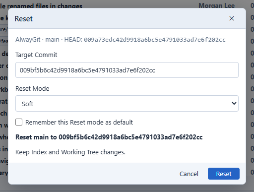

### Perform a standard Rebase

Use this entry to replay the current branch onto another base. To organize commits on their existing base, use [Interactive Rebase](#interactive-rebase).

**Prerequisite:** The current branch is the branch whose commits will be replayed. Others do not yet depend on those commits, or you have already agreed on the operation with your collaborators.

1. Switch to the branch you want to reorganize and create a backup branch at its current position.
2. Right-click the new base branch and choose Rebase….
3. Verify the current branch and the new base, then confirm to begin.
4. If conflicts occur, resolve them step by step, stage the changes, and Continue. Consider Skip only when you explicitly intend to discard the commit currently being replayed.
5. When finished, verify the commit contents and history relationships. If the result is unexpected, choose a recovery method based on the actual state.

**Result:** The current branch's commits have been replayed onto the new base. Commit IDs may change.

**Troubleshooting:** You can Abort while the operation is in progress. To recover after completion, use the backup reference saved beforehand; avoid further history rewriting without first checking the state.

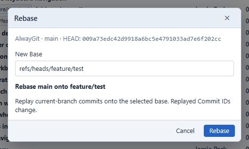

### Interactive Rebase: organize the current branch

Commit or Stash working files, staged changes and untracked files first. Right-click the current local branch and choose Interactive Rebase to load up to 20 recent unpublished commits, or choose Interactive Rebase from this commit from a commit menu to include that commit and all following commits through HEAD. Root commits, merge-containing ranges and active Git operations are unsupported; explicit ranges allow up to 500 commits.

1. Check the branch, original HEAD and fixed base. After editing the starting commit, use the refresh icon to load a new plan.
2. Work from oldest to newest. Drag rows, use the arrow buttons, or press Alt+Up/Down. Choose pick (keep), reword (edit message), squash (combine and edit), fixup (combine and discard this message), or drop (remove). Squash/fixup require an earlier retained commit. A squash message is the complete message of the combined commit.
3. Select a commit to inspect its files and independent Diff. A range reachable from cached remote refs requires explicit risk acknowledgement. This check does not Fetch, so actual remote state can be newer.
4. Execute the reviewed plan. Plans expire after fifteen minutes; changed HEAD or branch requires reloading. Rebase never pushes automatically and does not update other local branch refs.
5. If paused, choose Review paused Rebase. Resolve and stage conflicts, review the result, then continue. An emptied commit can explicitly be kept empty or skipped. Skip discards the current commit and its resolution changes and requires confirmation. Abort returns to the original position. Controls recover after window reload. Missing or changed saved helpers block continuation and permit abort, protecting reviewed messages.

Skip is disabled when replay already created the commit but message editing failed; Continue retries the reviewed message, or Abort restores history. An internal checkpoint failure disables Continue and Skip; abort and prepare a new plan.

The original HEAD remains under `refs/alwaygit/rebase-backups/…` after completion or abort. Inspect it through [Reflog](#reflog-recovery) and create a recovery branch. Existing hooks and signing configuration remain active; fix hook or signing failures before retrying, or abort.

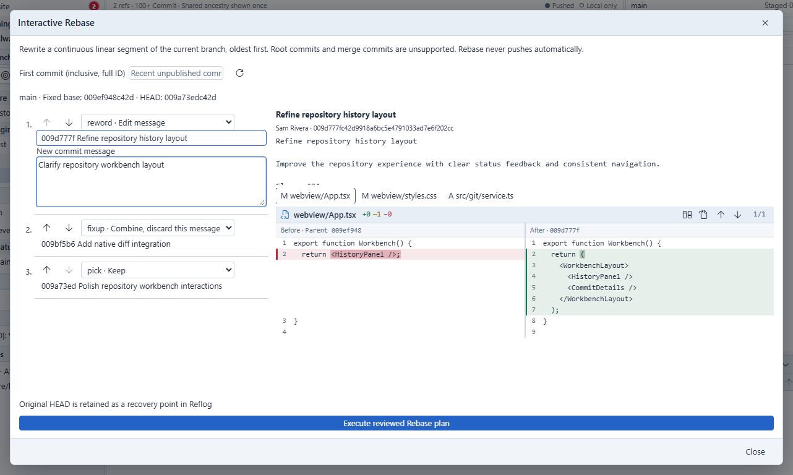

## Repositories and Project Groups

First select the item you intend to operate on, then identify the current working repository. A blue selected row identifies the target of an action. The highlighted repository icon marks the current repository; a solid triangle marks the current Worktree or local branch. The current item and action selection can differ. Repositories, Local Branches, one Remote, Tags, and Worktrees retain only one blue action-selection scope at a time. Moving to another object type clears the previous blue selection without changing the current repository, current branch, or Graph checkboxes.

Click list whitespace or press Esc to clear the blue selection while retaining a thin focus outline on the previous item. Click History, Details, or another region to remove that outline too. The outline identifies the keyboard position; the current repository is identified by its accented checked repository icon and bold name. Context menus and their confirmation dialogs retain the operation targets. Esc first closes a menu; pressing Esc again in the list clears selection.

### Add one repository or discover several

**Prerequisite:** The target directory is already a Git repository, or contains several Git repositories, and you have permission to read these directories.

1. Click the Add… plus button to the right of the Repositories heading and choose Add Repository.
2. Click Choose Folder… in the center of the dialog. Select a repository directory, or a parent directory containing multiple projects. Close the initial page with the top-right close button or Esc.
3. Wait for the scan to finish. Check the repository names and whether each can be added or has already been added. Clicking a checkbox adds or removes that repository without clearing other checks. Use Shift for a visible contiguous range, or filter as needed.
4. Select the target group, or Ungrouped. To create a group, click the plus beside Add to and enter its name in place. The add action creates the group and imports the selected repositories together. Check the number shown on the primary add button, then confirm.
5. Double-click a newly added repository in the navigation, or focus its row and press Enter.

**Result:** The selected repositories appear in the navigation. Existing repositories are not added again; only the repositories included in your final confirmation are registered.

**Caution:** Once the scan finds a valid repository, it does not continue scanning inside it, so it will not also discover nested repositories or submodules. Closing or canceling the scan does not add a partial selection.

**Troubleshooting:** Inaccessible directories are skipped. Review the reasons in the scan results, check the paths and permissions, then retry those directories individually. If confirmation fails, the scan results, checks, filter, and destination group remain available so you can address the error and retry. An expired scan requires choosing the directory again.

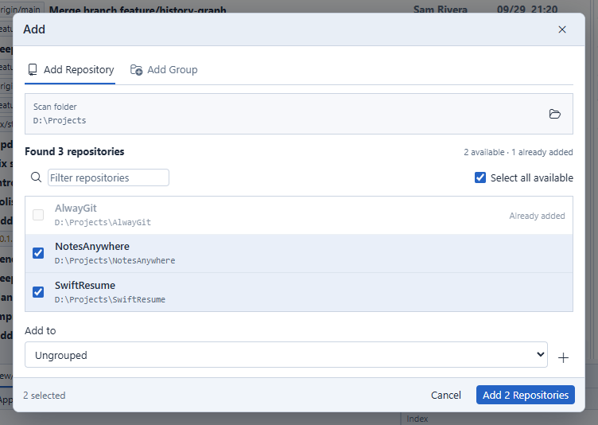

### Create and organize project groups

1. In the Add… popover, switch to Add Group, enter a name, and create the group.
2. Right-click one or more repositories, choose Move to Repository Group…, then select the target group.
3. Click a group heading to expand or collapse its contents. To change the order, drag items at the same level or use the move-up and move-down options in the context menu.
4. Right-click a group to rename or delete it. Read the confirmation message before deleting.

**Result:** Repositories are arranged by your project categories. When you delete a group, its repositories return to the root level.

**Caution:** Groups organize the navigation only. They do not move directories on disk or combine the contents of different repositories.

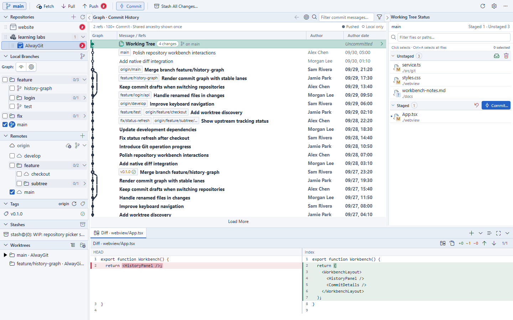

### Select items and switch repositories

**Prerequisite:** Confirm that the target repository has been added.

1. Clicking a repository name once only selects it as the target of an action. Hold Ctrl (Cmd on macOS) to add or remove individual selections, or Shift to select a contiguous range of visible items.
2. To actually switch the current repository, double-click the target repository, or select it and press Enter.
3. After switching, check the current repository icon, branch name, and Working Tree before performing any write operation.

**Result:** The workbench shows the target repository’s history and file status, and a single-click batch selection is not mistaken for switching repositories.

**Caution:** Within the repository navigation scope, Ctrl/Cmd+A selects all logical repositories; Escape clears the action selection. Inside text fields, these shortcuts still edit text.

### Remove repositories from the navigation

**Prerequisite:** You only want to stop showing these repositories in the AlwayGit list.

1. Right-click one repository or several selected repositories, then choose Remove from AlwayGit….
2. Read the complete repository list in the confirmation popover, then confirm the removal.

**Result:** The repositories no longer appear in AlwayGit navigation; their files and Git data remain in their original locations on disk.

**Caution:** Removing a repository from AlwayGit is not the same as deleting its directory from disk. Removing the current repository returns the workbench to a state with no repository selected.

**Troubleshooting:** To show the repository again, explicitly use Add… to add the original directory again.

### Open a new tab or project window

**Prerequisite:** Confirm which repository or Worktree you want to open.

1. To view projects side by side, right-click a repository and choose Open in New AlwayGit Tab.
2. To edit the project, use Open Repository in New Project Window or More actions → Open Repository Folder at the top.
3. To open a blank, separate workbench window, use Open Workbench in New Window in the launch sidebar, then select a repository in the new window.

**Result:** The new tab retains its own viewing position, and the project window is used for native file editing.

**Caution:** Each tab has its own view state, but the underlying Git repository is shared. Concurrent write operations and changes made by external tools can affect other views.

## Using Multiple Working Directories at Once

Worktree lets a single repository have multiple working directories so you can work on different branches at the same time. They share Git storage and some references, but each directory's files, Index, and commit draft must be checked separately.

### Inspect the status of every Worktree

Click the overview icon beside **Worktrees** to inspect every Git-registered worktree for the current logical repository, including directories not yet added to repository navigation. The table becomes cards in narrow windows. Rows show branch or Detached HEAD, short HEAD, staged/unstaged/untracked/conflict file counts, upstream, locally cached ahead/behind, active Git operation, locked/missing/read-error state, and last refresh time. Staged and unstaged counts can include the same file; conflicts are separate. This view performs no Fetch and does not indicate live Agent activity.

Results fill in batches and retain readable rows when another directory fails. File events refresh the affected worktree; the refresh icon rereads all directories. Row icons select that worktree in AlwayGit, open its project window, or create a terminal in its directory. These actions are disabled for missing, unreadable, and bare repositories. Closing returns to the existing Graph/File History with selection, layout, and drafts retained. Closing or changing repositories cancels unfinished reads.

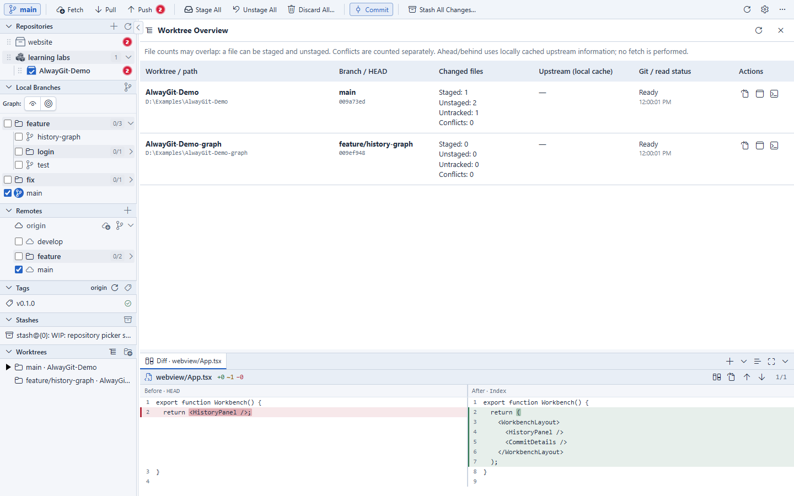

### Add a Worktree

**Prerequisite:** Select the repository the Worktree will belong to, and prepare a suitable new working directory and a branch that is not already in use.

1. Click Add Worktree… in the Worktrees heading.
2. Enter a new working directory in Worktree Folder, or select one with Browse. Avoid accidentally using an existing project directory.
3. To use an existing branch, select a branch that is not already in use under Existing Branch. To create a new branch, set Existing Branch to None, enter a name in New Branch, and verify Start Point.
4. Verify the path and any messages about branches already in use, then confirm creation.
5. Find the new directory under Worktrees and double-click it or press Enter to switch to it.

**Result:** The new working directory appears under Worktrees for the current repository. At the top level, Repositories still groups it under the same repository.

**Caution:** Creating a Detached Worktree is not allowed by default. Do not confuse a separate clone with a linked Worktree.

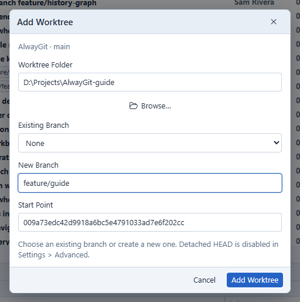

### Switch Worktrees or open one in a project window

1. A single click on a Worktree only selects it as the target for an operation. Double-click or press Enter to switch the current working directory.
2. Check the triangle marking the current Worktree, the branch, and the file status in Working Tree.
3. To edit in a separate VS Code project, right-click and choose Open Worktree in New Project Window.

**Result:** The workbench and editor window correspond to the correct directory, so changes are not mistaken for changes in another working directory.

**Caution:** Multiple Worktrees for the same repository appear as one logical repository entry, but their file statuses and Indexes are not combined.

### Remove a Worktree you no longer need

**Caution:** This removes the target Worktree's actual working directory. Forced removal can discard uncommitted files. It differs from removing a repository from AlwayGit navigation. The main directory, the current directory, and a locked state can all prevent removal.

**Prerequisite:** The target is neither the main Worktree nor the current Worktree, and its changes have been saved.

1. Switch to another working directory first.
2. Right-click the target Worktree and choose Remove Worktree…. For a batch, use Ctrl/Cmd-click or Shift-click, then choose Remove N Worktrees…. Removal is disabled when the selection contains the main, current, or a locked Worktree, with the blocking reason shown.
3. Verify every directory, any reason for locking, and the confirmation message. The force choice reads the independent Worktree removal default in Settings → Advanced → Git Operations and can be overridden once. Remember this selection as the default saves on or off after at least one removal succeeds, never on cancellation or total failure. A preference save failure is reported separately. Force can discard uncommitted files and still requires final confirmation when enabled by default.
4. Click Remove Worktree. If a native Proceed confirmation appears, check the directory again before continuing.
5. After confirming, check the Worktrees list and the result on disk. Batch results list successful and failed targets. Ordinary removal never automatically switches to force when uncommitted changes block it. A changed protection state or unconfirmed Git termination stops subsequent removals.

**Result:** The target Worktree's directory has been removed. The branch reference may remain and must be managed separately.

## Bottom Dock and Embedded Terminals

### Create terminals and switch tabs

The plus icon creates a terminal at the current repository root. Its dropdown selects the default shell, PowerShell, cmd, or Bash (the shell must exist on the host). Terminals and Diff share the panel height. Switching repositories keeps existing terminal directories; clicking a file selects Diff, while background refreshes keep the active tab.

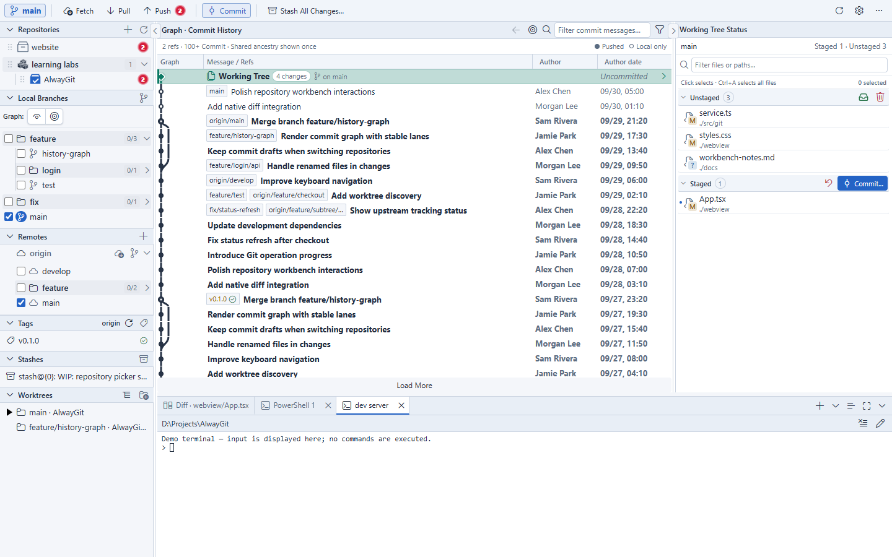

### Manage terminals and exited shells

Double-click a terminal tab to rename it. The toolbar clears the display and offers restart only after the shell exits; exit codes and output remain visible. Closing a terminal ends its shell; collapsing the panel or hiding the workbench keeps it running. Temporarily disabling that display location also keeps receiving output, available when you enable the location again. Use All tabs to switch among many terminals and maximize to expand the panel temporarily. Ctrl+C with a selection or Ctrl+Shift+C copies; Ctrl+Shift+V pastes. Without a selection, Ctrl+C interrupts the shell command. Closing the workbench or reloading VS Code releases terminals; commands and output are not saved or restored. The command palette also provides `AlwayGit: New Embedded Terminal`, with `Ctrl+Alt+Shift+T` as the default shortcut (`Cmd+Alt+Shift+T` on macOS).

## Settings and Common Questions

### Set the language and display appearance

1. Click the gear in the upper-right corner to open settings.
2. Choose a language, theme, text and density, file list, Diff, or Commit Graph page as needed and check the preview.
3. Interface contains reading preferences, including path display, text wrapping, and change navigation scope. Use the interface hints for auxiliary options.
4. Click Apply to save. To discard unapplied changes, click Cancel, close settings, or press Esc.

**Result:** Language, theme, colors, font sizes, density, shortcuts and reading preferences are saved in user settings and shared with other workbench windows in the same configuration environment. Cancel rolls back only this panel’s unapplied preview. Panel dimensions, browsing state and commit drafts are restored separately.

**Caution:** The Simplified Chinese interface translates ordinary actions and objects such as Stage, Commit, Fetch, Push, Merge, Tag, and Worktree. Rebase, Cherry-pick, Graph, Stash, HEAD, Index, and Diff retain their Git names. Paths, branch names, user content, and raw Git output remain unchanged.

Git operation settings default to User. Select Current workspace before editing to override the defaults for that VS Code workspace. Workspace overrides remain effective after user defaults are saved; empty windows cannot save workspace settings. The workspace scope covers all repositories managed in that window.

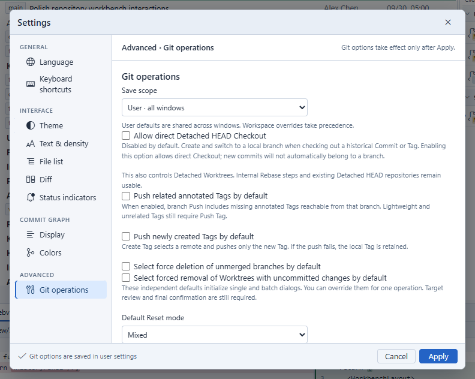

### Why will a file or native Diff not open?

**Prerequisite:** The error message is Trust the project workspace before opening it from AlwayGit, and you have verified that the project comes from a trusted source.

1. Switch to the VS Code project window for the target repository. It may already have been created but not brought to the front because the trust check failed.
2. If that window does not exist, use File → New Window, then File → Open Folder… to open the target repository directory.
3. In the target window, run Workspaces: Manage Workspace Trust or click Restricted Mode. Trust the project directory only after confirming that it is trustworthy.
4. Confirm that the target window uses the same Profile and has AlwayGit enabled, then return to the original workbench and reopen the editor or Diff.

**Result:** The native editor or Diff opens in the correct trusted project window.

**Caution:** Adding a repository to the AlwayGit repository list does not mean its directory is trusted. You do not need to trust all of a project's parent directories just to trust that project.

### Adjust and restore the layout

**Prerequisite:** You want to redistribute space among history, details, and Diff.

1. Drag dividers to resize panels, or use sidebar arrows to collapse and expand them. Narrow windows provide region navigation; press Esc during a drag to cancel the adjustment.
2. Drag the visible boundaries of the Graph, author, and date columns to adjust their widths.
3. Use the Diff title-bar icons to collapse or restore the lower panel.
4. Select More actions → Restore Layout when you want to restore the layout.

**Result:** The reading area suits the current task. Restore Layout restores the dimensions and expands both sidebars and Diff.

**Caution:** Restore Layout does not clear the language, theme, or commit draft.

### Read error feedback before retrying

The results bar retains the operation name, target, and success or failure status. If an error occurs, first expand the full error, check the current repository and the in-progress operation bar, and then open the logs. After switching repositories, do not treat a result from another repository as the outcome of the current operation.

| Symptom | Check first | Next step |
| --- | --- | --- |
| A repository is selected in blue, but the content has not switched | Whether you only single-clicked to select the item | Double-click or press Enter, then check the current repository icon |
| Ordinary Commit is unavailable | Whether there are Staged files or conflicts | Check the staged scope and the operation bar; Amend can run without Staged files when only the message is changing |
| Switching branches is blocked | Files that might be overwritten and whether the branch is in use by a Worktree | Save your changes or open the Worktree using that branch |
| Push fails | The target, authentication, permissions, and whether the remote has advanced | Fetch and compare first, then address the error |
| Diff cannot complete | Whether the file is binary, has encoding issues, or reached a resource limit | Check the error; text is limited to 32 MiB per side, with no partial comparison shown on failure |
| The commit graph has no connecting lines | Whether a search is active or no references are checked | Clear the search or adjust the reference scope |

### Git LFS objects and common operations

Historical commit, comparison, and full-tree previews use cached LFS content after verifying its SHA-256 and size. Text is limited to 32 MiB per side and images to 4 MiB per side. Missing objects show their ID, size, and a download action. Select a remote and confirm to fetch only the fixed commit/path object into the cache, then refresh the current preview without checking out the commit or restoring working files. Isolated previews do not offer downloads; oversized local content shows a specific explanation.

Open **Git LFS** from the toolbar's More menu, a repository context menu, or a file context menu. The panel checks the current extension host's Git LFS version and process-filter configuration on demand. It lists LFS files in the current index, full SHA-256 object IDs, sizes, pointer or content state in the working tree, and local object-cache state. A present cache entry checks file type and size only; it does not verify the content hash. Status checks never download objects. If Git LFS is unavailable, the panel explains the host requirement without installing tools or changing Git configuration.

| Operation | Scope |
| --- | --- |
| Fetch current objects | Download LFS objects referenced by the current commit into the cache; leave working files unchanged |
| Fetch selected | Download selected list objects still referenced by the current commit; paths containing commas or trailing whitespace require fetching the whole current commit |
| Restore from cache | Replace current LFS pointers from existing cached objects without contacting the remote; Git LFS protects modified files |
| Download and restore | Run LFS pull for the current branch, downloading objects and restoring files without fetching or merging Git commits |
| Retry branch object upload | Upload the current local branch's LFS objects to the chosen remote without pushing Git branch references |

Choose a remote and explicitly start an operation. Failures retain errors and logs; resolve authentication, permissions, network, or missing-object problems before retrying. AlwayGit does not rerun failed commands; Git LFS transfer and SSH retry settings use their supported minimum. The Git LFS status area retains its pending upload candidates and staging information. Candidates are inferred from local refs and configuration and **do not verify remote object availability**. The file list shows at most the first 1,000 entries and supports refresh. Status and selection are bound to the current branch and HEAD. Changes to the Git/LFS destination configuration require a fresh review; network commands use the captured configuration snapshot.

Tracking rules accept literal filenames or glob patterns. Preview the root `.gitattributes` changes before applying them. Unrelated rules and the index remain intact; edits remain unstaged. Literal filenames are anchored to the repository root and escape glob characters according to the host platform; patterns ending in whitespace require manual attribute editing. Switching branches or changing HEAD invalidates the preview. Untrack removes only an exactly matching standard LFS rule; custom rules and nested attributes need manual review. Adding or removing a rule does not migrate existing content, rewrite history, or re-stage files. Migration, cache pruning, file locks, and global Git configuration are outside this panel's scope.

### Environment requirements and support boundaries

Basic functionality requires VS Code 1.106+ and Git 2.40+. Saving selected files in a Stash and isolated restoration with Apply / Pop require Git 2.43+; force-with-lease pushes, remote branch deletion and remote Tag deletion require Git 2.46+. When using a remote host, also check the Git version on that host.

Git runs in the VS Code extension host where the repository resides. The product architecture is designed for local environments, WSL, Remote SSH, and Dev Containers; Git, paths, permissions, and authentication still need to be verified separately in each environment. Git is not executed in untrusted workspaces, and browser-only virtual workspaces are not supported.

**Conflict workflow:** Choose Resolve conflicts in the operation bar and inspect each file and both source commits. Open the native merge editor for ordinary text, save, then mark and stage. Manual working-file editing remains available when native integration is unavailable. For modify/delete conflicts, explicitly choose a complete side or its deletion; this replaces saved manual edits and still requires staging. During Rebase, stage 2 is the target result and stage 3 is the replayed commit. After resolving remaining entries, review staged results before Continue. Refresh changed or expired choices; staged does not mean correct.

Current scope: whole-file and Git-hunk staging, standard and interactive Rebase, commit reordering, Squash/Fixup, remote branch management, explicit Tag Push, and lease-protected remote Tag deletion. Not currently provided: Format Patch, remote Tag replacement, or freely floating panels.

| Setting | Default or range | Description |
| --- | --- | --- |
| alwaygit.gitPath | Empty; machine scope | An explicit path takes precedence; otherwise, the path from the built-in Git extension or PATH is used |
| alwaygit.historyPageSize | 300; 50–1000 | Maximum number of actual Commits loaded per page |
| alwaygit.refreshInterval | 15 seconds; 5–300 seconds | Fallback refresh interval while the workbench is visible |
| alwaygit.allowDetachedHead | false | Advanced policy for entering Detached HEAD directly |
| alwaygit.pushFollowTags | false | Whether normal Push includes related annotated Tags by default |
| alwaygit.pushTagAfterCreate | false | Whether a new Tag is pushed to the selected Remote by default |
| alwaygit.defaultResetMode | mixed | Soft, Mixed, or Hard initially selected in the Reset dialog |
| alwaygit.forceDeleteUnmergedBranches | false | Initially select Force for single and batch local branch deletion; final confirmation remains |
| alwaygit.forceRemoveDirtyWorktrees | false | Initially select Force for single and batch Worktree removal; final confirmation remains |
| alwaygit.language | en / zh-CN / auto; user scope | Display language; applied user settings synchronize across Workbenches |
| alwaygit.interfaceSettings | Object; user scope | Appearance, font, density, file lists, shortcuts, and Diff reading preferences |
| alwaygit.workbenchLocations | editor only by default; user scope | enabled locations and a default belonging to that list |

Reload the VS Code window after changing the Git path or refresh interval. Theme, color scheme, font size, density, and language settings within the workbench take effect immediately after you apply them.

## Quick Reference

### Selection and keyboard shortcuts

Single-key shortcuts are enabled by default. The table below lists default bindings; in-app Help displays current effective bindings. Shortcuts work throughout the focused AlwayGit workbench, including repositories, History, file lists, Diff, buttons and blank areas. Global shortcuts pause in text inputs, textareas, editable content, selectors, input-method composition, dialogs and context menus. When focus moves to a VS Code editor or terminal, that view handles the keyboard. Holding a key does not repeat an operation.

| Key | Action | Scope and behavior |
| --- | --- | --- |
| R; Ctrl/Cmd+R | Refresh | Refresh the repository currently open in the toolbar |
| F | Fetch | Same as the toolbar button |
| L | Pull | Open the Pull dialog |
| P | Push | Open the Push target confirmation |
| C | Prepare Commit | Open the Commit dialog and focus the message; does not submit |
| S | Stash All Changes | Open the dialog for saving all changes |
| W | View Working Tree | Inspect uncommitted changes without focusing a text input |
| H | Locate HEAD | Follow the existing HEAD location and history scope rules |
| O | Open repository folder | Open or switch to the current repository's VS Code window |
| D | Open Diff | Open native Diff for the current text preview; disabled for images and binary files |
| E | Open working tree file | Same as Open File in VS Code; always opens the actual current Working Tree file and reports missing paths; disabled for images and binary files |
| [; ] | Previous; next change | Follow the Diff navigation scope; expand a collapsed Diff before navigating |
| \ | Minimize/expand Diff | Preserve the reading position |
| / | Search commits | Focus and select the Commit search text |
| , | Settings | Open Settings |
| ? (Shift+/) | Help | Open Help & Guide |
| A; U | Stage All; Unstage All | Split mode: Working Tree only, confirming the matching scope. Unified mode: confirm the complete repository from any detail view, ignoring filters and selection |
| N | New embedded terminal | Expand the bottom panel and create a default shell at the current repository root |
| T | Focus current terminal | Switch from Diff to the most recently created terminal; create one when no terminal exists |
| Ctrl+Alt+Shift+T; macOS Cmd+Alt+Shift+T | New embedded terminal | VS Code command that can open the workbench; without a current repository, waits for repository selection before creating a terminal |

D, E, [, ], and \ are available only while the Diff tab is active. Terminal inputs suspend workbench single-key shortcuts. Global actions target the currently open repository and preview file. Temporary sidebar selection and pointer hover do not change their targets. Disabled buttons have disabled shortcuts. A/U follow the list-mode scope in the table above, independently of batch selection or collapsed groups; use the existing context menu for selected-file actions.

| Action | Meaning | Scope reminder |
| --- | --- | --- |
| Single-click a repository or Worktree | Select the target for an operation | Does not switch the current working directory |
| Double-click a repository or Worktree / Enter | Actually switch | Check the current item before and after the action |
| Check a reference | Change the Graph scope | Does not Checkout |
| Ctrl/Cmd + click | Add to or remove from a multiple selection | Right-clicking a selected item preserves that selection scope |
| Shift + click | Select a contiguous visible range | Collapsed directories affect the visible order |
| Ctrl/Cmd + A | Select all within the scope that currently has focus | In an input field, still selects all text |
| Escape | Clear the selection in the current scope or close a menu | Input fields retain their native behavior |
| Shift + F10 / Menu key | Open the current item's menu | Use the arrow keys to move and Enter to execute |
| Select exactly two Commits in History | Automatically Compare Commits | Working Tree is not included in Commit multiple selection |

Select all in the sidebar makes the focused scope the sole action-selection scope. Escape clears that scope without activating another. Branch action selection is independent of Graph ref checkboxes, so these keys do not change history filters.

In file lists, an ordinary click selects only that entry and switches the bottom Diff. Ctrl/Cmd-click, Shift-click, and Ctrl/Cmd+Shift-click only change the selection; Ctrl/Cmd+A and Escape also keep the current Diff. Row backgrounds indicate operation selection and clear immediately when deselected. A small dot beside the file icon marks the version currently being previewed; keyboard focus uses a thin outline. Click whitespace in Changed Files to clear selection while retaining the thin focus outline; move to Diff, History, or another region to remove the outline too. These actions retain the current Diff and its small preview marker. File icons and row padding also select the file. Path filters, Copy Paths, and context menus retain the selection needed for their actions.

### Customize shortcuts and restore defaults

Hover over supported actions to see their current bindings. Settings → General → Keyboard shortcuts provides search, category filters and an Only modified filter. Click a binding to record its replacement, or use the plus icon to add an alternate; each action supports up to two bindings. The close icon removes one binding, the disable icon clears the action, and the restore icon restores its defaults. The top restore button restores all defaults.

Focus the recording field and press a single key or combination. Ctrl/Cmd adapts to the platform. Esc cancels recording without closing Settings; Tab moves to confirmation. Conflicts show the actions using the key and block normal confirmation; Move binding here explicitly removes their conflicting bindings. Restoring defaults also requires moving conflicting bindings when necessary. Basic navigation, selection and text editing keys are reserved; input-method composition and AltGr are excluded from recording. Multi-step chords are not supported. VS Code or the operating system may handle combinations first; external conflicts are not fully checked here.

Apply saves bindings in user settings and shares them across windows; Cancel restores previous bindings. Turning off single keys pauses bindings without modifiers and Shift with printable characters while retaining their configuration; other combinations remain active. The default Ctrl/Cmd+R can be changed or disabled. Existing selection controls, drafts, repository selection and layout are preserved. The separate New Embedded Terminal shortcut is managed by VS Code through the Open VS Code Keyboard Shortcuts entry.

### Common terms

| Term | Meaning here |
| --- | --- |
| HEAD | The currently checked-out version; usually points to the latest commit on the current branch |
| Index / Staged | The file contents prepared to be saved by the next Commit |
| Unstaged | Changes on disk relative to the Index that have not yet been staged |
| upstream | The remote branch tracked by a local branch |
| OID / Commit ID | A Git object identifier; a short hash is easier to read, while the full ID provides an exact reference |
| Detached HEAD | A commit is checked out directly, without being attached to an ordinary local branch |
| Merge Parent / Mainline Parent | A parent version of a merge commit; choosing a different parent changes the meaning of the comparison or the changes being taken |
| Worktree | Another working directory that shares the same repository's Git storage |

### Find an operation by goal

| What I want to do | Where to go |
| --- | --- |
| Save current file changes as a version | Working Tree → Stage → review Staged → Commit |
| Set changes aside to work on something else | Stash All Changes or Stash Selected Files |
| See what changed between two versions | Select exactly two Commits in History |
| Find commits by author, date, path, or code | [History advanced search](#section-04-02) |
| Trace a file through changes and renames | [File menu → Show File History](#file-history) |
| Read old files that a Commit did not change | [Commit Details → Full Tree](#commit-tree) |
| Compare branch progress without switching | [Branch menu → Compare with Current Branch](#branch-comparison) |
| Recover commits from before Reset or Rebase | [More → Open Reflog](#reflog-recovery) |
| Reorder, combine, or reword unpublished commits | [Current branch menu → Interactive Rebase](#interactive-rebase) |
| Inspect changes across working directories | [Worktrees heading → Overview](#worktree-overview) |
| Inspect or download large-file objects | [More or file menu → Git LFS](#git-lfs) |
| Integrate all progress from another branch | Make the target branch current → right-click the source → Merge |
| Take only the changes from one commit | Make the target branch current → Commit menu → Cherry-pick |
| Undo the effects of a commit that has already been shared | Commit menu → Revert |
| Return to an older version and continue development | Old Commit → create a branch and switch to it |
| Synchronize new references from the server | Remote → Fetch |
| Send local commits to collaborators | Push → verify the target |
| Edit two branches at the same time | Worktrees → Add Worktree |

### Conventions used in this manual

Sample repositories, branches, and files are for demonstration. Actual project names, commit IDs, themes, and window sizes may differ. The instructions describe current behavior; the screenshot source is explained at the start of this manual. Verify the objects, counts, and scope shown by the current controls before executing an action.
